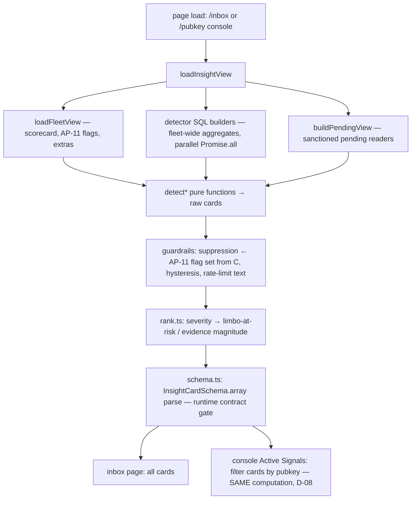

# Phase 4: Insight Engine - Research

**Researched:** 2026-06-11
**Domain:** Deterministic detection engine over Postgres warehouses (Drizzle raw-SQL aggregates), frozen TS/zod schema contract, severity-ranked triage UI, optional LLM narrative
**Confidence:** HIGH (detector signatures and thresholds derive from operator-verified `_library` docs + live-verified warehouse schema annotations; only the stuck-open window and lower-fee signal are LOW)

<user_constraints>
## User Constraints (from CONTEXT.md)

### Locked Decisions

**Card schema & freeze mechanics (INSIGHT-01)**
- **D-01:** Severity reuses the scorecard taxonomy: `critical | warn | info` — same Tier-1 ("page") vs Tier-2/3 line as `SCORECARD_CONFIG.tier1` (Phase 2 D-07/D-08). No second severity taxonomy. UI reuses the existing severity-tinted chips (sketch findings).
- **D-02:** Freeze = versioned TS type (`schemaVersion` field) + zod runtime validator + a contract test that fails on any shape change. Phases 5 and 6 import the SAME zod schema — it is the contract artifact.
- **D-03:** `suggested_action` + `params` are a discriminated union per action type (e.g. `update_fee` / `close_channel` / `rebalance` / `remediate_pending` / `investigate` — exact enum at planner's discretion). Each action type carries its own typed params object. Rationale: Phase 6 signs `canonical(params)` — loose typing here would leak into the signing surface.
- **D-04:** Evidence is structured: metric name, observed value, threshold breached, window, plus a deep-link URL into the relevant console tab (Phase 3 D-03 stable URLs). The inbox sorts/filters on it; the LLM narrates from it.

**Triage inbox (INSIGHT-03)**
- **D-05:** New dedicated inbox page (e.g. `/inbox` or `/insights` — route name at planner's discretion). The Phase-3 Attention Queue stays a scorecard-breach feed; the inbox is the recommendation-card surface. Clean separation: grades vs recommendations.
- **D-06:** Ranking: severity first (critical → warn → info); within a severity band, stuck-pending cards rank by limbo balance at risk (PENDING-02 AC), others by evidence magnitude. Deterministic, no tuning knob.
- **D-07:** Cards are stateless — pure functions of warehouse state, recomputed each load, disappearing when the condition clears. No ack/dismiss persistence, no nodemon writes this phase.
- **D-08:** Cards also surface per-node in the console's Active Signals panel (03-14): inbox = fleet-wide view, console = per-node view of the same cards.

**Detector definitions & data gaps (INSIGHT-02/04/05, PENDING-02)**
- **D-09:** Fee-crash / earnings-step-down algorithm is researcher-derived from the France PPM-crash reference data in `lqwdLogs` (drop %, window, baseline definition). Starting values land in the detector config as tunable knobs.
- **D-10:** Fleet temporal-correlation (close-cluster) rule is derived from the 2024-09-09 cascade signature reconstructed from warehouse close data — ≥N nodes with self-closes in the same hour; N + window are config knobs.
- **D-11:** AP-12a/b LLM fallback: if research confirms no warehouse data source for connection-exhaustion / serialization-storm, the engine leans on the LLM to make the most educated inference — clearly labeled that no warehouse data is present and this is an LLM suggestion.
- **D-12:** LLM-inferred AP-12 cards are advisory-only: severity `info`, NO `suggested_action` params (investigate-only), labeled "LLM inference — no warehouse data", never trigger guardrail suppression and never feed Phases 5/6. Deterministic detectors remain the only param producers. Gated behind the same off-by-default LLM toggle as the narrative — when LLM is off, AP-12 shows an honest "no data — needs log ingestion" placeholder.
- **D-13:** Detector thresholds live in a separate insight-engine config module (NOT folded into `SCORECARD_CONFIG`): step-down %, cluster N/window, stuck-pending windows, hysteresis knobs. Per-backend where relevant. Where a detector grades the same metric the scorecard grades (e.g. AP-11 close-storm Tier-1), it must READ the existing `SCORECARD_CONFIG` band rather than duplicate the number.

**Guardrails & LLM narrative (INSIGHT-06/07)**
- **D-14:** Suppression is visible: when a node is flagged AP-11/AP-12 (deterministic flags only, per D-12), write-recommendation cards still render with a SUPPRESSED state + reason ("node flagged AP-11 — write recommendations withheld"), params withheld/disabled.
- **D-15:** Fee hysteresis = min-delta + min-interval, both config knobs: a fee card fires only when the suggested change exceeds a minimum delta AND a minimum interval has passed since the last direction change. Card evidence shows the hysteresis state.
- **D-16:** Per-node write rate-limit is guidance text on cards (suggested-writes-this-window counter); hard enforcement lands in Phase 6/7.
- **D-17:** LLM narrative triggers at BOTH levels: an inbox-level button narrating the flagged card set fleet-wide, AND per-node narration (console/card level). Server-side via the `getModel()` pattern, rendered clearly marked as LLM output, off by default.

### Claude's Discretion
- Exact action-type enum membership and per-action param field names (must cover update_fee, close, rebalance, pending-remediation, investigate semantics needed by Phases 5/6).
- Card identity/dedupe key design (stable enough for the console/inbox to render the same card consistently within a load).
- Inbox route name, layout, grouping presentation, empty state, freshness stamp placement — driven through the design skills (sketch-findings-nodemonitor + frontend-design are binding for all UI).
- Engine module layout (detector-per-module mirroring the dimension-module pattern is the natural shape).
- Stuck-pending thresholds (maturity windows, broadcast_attempts line, aged-open window) — researcher proposes from `_library` guidance; config knobs.
- HTLC-timeout signature and rebalance-success signal mechanics — researcher maps from warehouse columns honoring AFM-001/002.

### Deferred Ideas (OUT OF SCOPE)
- Fleet-page inbox entry strip / top-N card preview — operator chose the dedicated page only.
- Persisted ack/snooze/dismiss card state — needs nodemon writes; revisit at/after Phase 6.
- Hard per-node write rate-limit enforcement — Phase 6 (queue) / Phase 7 (node-side); this phase ships guidance only.
- Real AP-12a/b detectors from log ingestion — when log/pg_stat ingestion lands, the LLM fallback retires.
- Scheduled/cron card refresh — explicitly v2; v1 computes on-demand.
</user_constraints>

<phase_requirements>
## Phase Requirements

| ID | Description | Research Support |
|----|-------------|------------------|
| INSIGHT-01 | Structured cards `{severity, node, target, signal, evidence, suggested_action, params}` from `_library` thresholds; schema frozen as hard contract | §Card Schema — discriminated-union design, zod validator placement, contract-test mechanics, dedupe key |
| INSIGHT-02 | Deterministic detectors: AP-11 close-storm, AP-12a/b, HTLC-timeout force-close signature, fee signals, rebalance-success | §Detector Catalog — per-detector data source, algorithm, severity, knobs; §Data Gaps for AP-12a/b LLM fallback |
| INSIGHT-03 | One fleet-wide severity-ranked triage inbox | §Engine Architecture (one engine, two views) + §UI Surface |
| INSIGHT-04 | Fee-crash / earnings-step-down detector | §Detector Catalog D-09 — algorithm derived from France routing-pnl weekly series, with golden-fixture validation |
| INSIGHT-05 | Fleet-wide temporal close-cluster correlation detector | §Detector Catalog D-10 — N/window derived from 2024-09-09 + post-migration cluster evidence |
| INSIGHT-06 | Suppress write recs to AP-11/AP-12 nodes; fee hysteresis; rate-limit guidance | §Guardrails — suppression via forceClose tier1Breach, stateless hysteresis from channel_info fee history, guidance counter |
| INSIGHT-07 | Optional LLM narrative, off by default, narrates only | §LLM Narrative — getModel() pattern, env gate, both trigger levels, no-params-production invariant |
| PENDING-02 | Stuck-pending detector: force-close-past-maturity, stuck-sweep, stuck-open; ranked by limbo at risk | §Detector Catalog stuck-pending ×3 — columns from `read/pending.ts` view, proposed thresholds with `_library` justification |
</phase_requirements>

## Summary

Phase 4 is mostly an exercise in **disciplined reuse**: every detector data source already has a sanctioned reader or a live-verified schema annotation in-repo, the severity taxonomy and Tier-1 machinery exist (`grade.ts`), the dimension-module pattern (exported SQL builder + PgDialect shape test + lazy-import executor) is proven across 7 scorecard dimensions, and the AP-11 metric (`maxHourlySelfCloses`) is already computed by `force-close.ts`. The genuinely new work is: (1) the frozen card schema + zod contract (zod is NOT yet installed — it, `ai`, and `@ai-sdk/anthropic` are this phase's only new packages, all slopcheck-clean); (2) ~8 detector modules whose thresholds I have now pinned to specific `_library` lines with concrete starting values (tables below); (3) the stateless guardrail layer — suppression reads `loadFleetView()`'s forceClose `tier1Breach`, hysteresis is reconstructed deterministically from `lnd_node_channel_info` fee-rate snapshot history (no persistence needed); (4) the `/inbox` page + console Active Signals integration under the binding NOC-Light sketch findings.

The two researcher-derived algorithms resolve cleanly. **D-09 (fee-crash):** the France routing-pnl weekly table gives an unambiguous signature — PPM fell 20.7 → 2.27 (ratio 0.11) in one week while volume *rose*; the `_library` monitoring matrix already codifies the three rules (PPM-LOW < 10, PPM-DRIFT < 0.5× 4-week-prior baseline, EARNINGS-DROP 7d < 0.3× 4-week-prior) as Tier-1 pages — adopt those as the detector with a 28d-ending-7d-ago baseline. The France weekly series doubles as a golden test fixture. **D-10 (close-cluster):** AP-11's warehouse-reconstructed evidence (2024-09-09: France 213 + India 175 + Sweden 106 same day; post-migration 2025-07-16: Canada 101 + Australia 20 + Brazil 4) supports N=2 warn / N=3 critical with ≥5 self-initiated closes per node in the same hour bucket. **D-11/D-12 confirms:** AP-12a/b have NO warehouse source — `data-gap-inventory.md` lists Postgres `pg_stat_*`/lock-contention capture as an open Tier-2 gap, the monitoring matrix marks every PG signal "(Canada lacks)", and Phase 2 already declared `pgHealth` a NO_DATA dimension — so the LLM advisory-only path triggers exactly as D-11/D-12 prescribe.

**Primary recommendation:** Build `src/lib/insight/` mirroring `src/lib/scorecard/` exactly — pure `types.ts` + `schema.ts` (zod, the frozen contract) + `config.ts` (INSIGHT_CONFIG knobs) + `detectors/*` (one module per detector, fleet-wide single-query SQL builders) + `engine.ts` (`loadInsightView()`), with guardrails as a pure post-processing pass, and freeze the schema with a committed-fixture contract test before any UI work starts.

## Architectural Responsibility Map

| Capability | Primary Tier | Secondary Tier | Rationale |
|------------|-------------|----------------|-----------|
| Detector SQL + card computation | API/Backend (server-only lib, RSC data layer) | — | Warehouse reads require server-only DB clients; detectors are pure server modules like dimensions |
| Card schema + zod validation | Shared pure module (no server-only) | — | Phases 5/6 and tests import it; must be importable anywhere (scorecard `types.ts`/`config.ts` precedent) |
| Severity ranking / suppression / hysteresis | API/Backend (pure functions) | — | Deterministic post-processing of detector output; unit-testable without DB |
| Inbox page rendering | Frontend Server (RSC) | Browser (thin client leaves) | Server Components fetch `loadInsightView()`; established pattern — no client-side data fetching |
| Console Active Signals card integration | Frontend Server (RSC) | — | 03-15 builds SignalRow[] server-side; insight cards extend the same caller-built rows |
| LLM narrative | API/Backend (server action / route handler) | Browser (trigger button) | `getModel()` reads env API keys — server-only; client only triggers and renders marked output |
| Evidence deep links | Shared pure helper | — | URL construction from pubkey + tab + window key (`/{pubkey}/{tab}?window=…`) |

## Standard Stack

### Core (already installed — no change)

| Library | Version | Purpose | Why Standard |
|---------|---------|---------|--------------|
| next | 16.1.6 | App Router RSC | In place [VERIFIED: package.json] |
| drizzle-orm | ^0.45.1 | `sql` template raw aggregates + PgDialect shape tests | In place; every dimension uses it [VERIFIED: package.json] |
| postgres | ^3.4.8 | Driver | In place [VERIFIED: package.json] |
| vitest | ^4 | Tests | In place; `npm test` [VERIFIED: package.json] |

### New this phase

| Library | Version | Purpose | When to Use |
|---------|---------|---------|-------------|
| zod | **^3.25.76** | Frozen card-schema runtime validator (D-02) | The contract artifact. Pin the v3 line: CLAUDE.md stack constraint says `^3.23`, and `ai@6` peers on `zod ^3.25.76 \|\| ^4` — `^3.25.76` satisfies both [VERIFIED: npm registry — latest 4.4.3; v3 line still maintained; lqwd-node uses zod 3.23 per CLAUDE.md] |
| ai | **^6.0.202** | `generateText` for the narrative (D-17) | Off-by-default narrative only. `LanguageModel` type, provider factory call — v6 shapes per CLAUDE.md §5 [VERIFIED: npm registry 6.0.202; lqwdclaw production-proven on 6.0.x] |
| @ai-sdk/anthropic | **^3.0.83** | Default Claude provider for `getModel()` | CLAUDE.md mandates default Claude + `AI_MODEL` override [VERIFIED: npm registry 3.0.83; lqwdclaw uses 3.0.x] |

**Installation:**
```bash
npm install zod@^3.25.76 ai @ai-sdk/anthropic
```

Optional: `@ai-sdk/google` / `@ai-sdk/openai` only if the planner copies lqwdclaw's three-provider `getModel()` verbatim. Recommendation: ship anthropic-only with the same `parseModelOverride` switch shape, throwing a descriptive error for unconfigured providers (fail-loud, matches `backends.ts` ethos) — fewer packages, same env-override contract.

### Alternatives Considered

| Instead of | Could Use | Tradeoff |
|------------|-----------|----------|
| zod v3 line | zod 4.x | v4 is current major, but CLAUDE.md pins `^3.23` and Phase 6 signing code will import this schema — staying on the workspace-vetted line avoids a cross-phase major-version migration on the contract artifact |
| Stateless hysteresis from `channel_info` snapshots | nodemon DB table recording emitted fee cards | Persistence contradicts D-07 (stateless cards) and the queue DB belongs to Phase 6; snapshot-derived history is deterministic and testable |
| One fleet-wide query per detector | Per-node queries in a loop | 26 nodes × N detectors explodes query count; the dimension pattern (single `GROUP BY local_pubkey` aggregate) is proven and bounded |

## Package Legitimacy Audit

| Package | Registry | Age | Downloads | Source Repo | slopcheck | Disposition |
|---------|----------|-----|-----------|-------------|-----------|-------------|
| zod | npm | 6 yrs (created 2020-03) | very high (top-50 npm) | github.com/colinhacks/zod | [OK] | Approved |
| ai | npm | 3+ yrs | very high | github.com/vercel/ai | [OK] | Approved |
| @ai-sdk/anthropic | npm | 2+ yrs | high | github.com/vercel/ai | [OK] | Approved |

**Packages removed due to slopcheck [SLOP] verdict:** none
**Packages flagged as suspicious [SUS]:** none
**Postinstall scripts:** none on any of the three (verified `npm view <pkg> scripts.postinstall` — all empty).
All three are additionally production-proven in the sibling `lqwdclaw` repo (workspace authoritative truth per CLAUDE.md §Sources).

## Card Schema & Contract Freeze (INSIGHT-01, D-02/D-03/D-04)

### Recommended shape (planner refines field names; semantics below are research-pinned)

```ts
// src/lib/insight/types.ts — PURE module (no imports beyond zod inference), like scorecard/types.ts
export const CARD_SCHEMA_VERSION = 1 as const;

type Severity = "critical" | "warn" | "info";          // D-01: scorecard taxonomy verbatim

// Target — discriminated by kind. Fleet-scope cards (close-cluster) have no single node.
type CardTarget =
  | { kind: "node" }                                     // node-level signal (AP-11, step-down)
  | { kind: "channel"; chanId: string | null; channelPoint: string | null; remotePubkey: string | null }
  | { kind: "sweep"; outpointTxid: string; outpointOutputIndex: number }
  | { kind: "fleet"; pubkeys: string[] };                // close-cluster correlation card

// Evidence — D-04 structured: the inbox sorts/filters on it; the LLM narrates from it.
interface CardEvidence {
  metric: string;            // e.g. "maxHourlySelfCloses", "ppm_7d_vs_baseline"
  observed: number;          // RAW units (sats, PPM, counts, ratios) — AFM-002 formatter at render only
  threshold: number;         // the breached knob value (echoed from config at compute time)
  unit: string;              // "closes/hr" | "ppm" | "sat" | "ratio" | "blocks" | "attempts" | "hours"
  window: string;            // human window descriptor, e.g. "24h", "7d vs 28d-prior"
  asOf: string;              // ISO timestamp (serialized — cards must be JSON-serializable for Phases 5/6)
  deepLink: string;          // console tab URL: `/${pubkey}/${tab}?window=${key}` (Phase 3 stable URLs)
  detail?: Record<string, number | string>;  // detector-specific extras (settledRatio, limboSat, hysteresis state…)
}

// D-03 — discriminated union; Phase 6 signs canonical(params), so every params
// object must be flat, JSON-canonicalizable, and carry NO optional ambiguity
// beyond explicit nulls.
type SuggestedAction =
  | { type: "update_fee";        params: { chanId: string; channelPoint: string; currentPpm: number; suggestedPpm: number; baseFeeMsat: number; timeLockDelta: number } }
  | { type: "close_channel";     params: { chanId: string; channelPoint: string; force: boolean } }
  | { type: "rebalance";         params: { partnerPubkey: string; amountSat: number; direction: "out" | "in" } }
  | { type: "remediate_pending"; params: { case: "bump_fee" | "restart_procedure" | "aged_funding"; channelPoint: string | null; outpointTxid: string | null; suggestedSatPerVbyte: number | null } }
  | { type: "investigate";       params: Record<string, never> };  // empty object, NOT undefined — uniform canonical signing surface

interface InsightCard {
  schemaVersion: typeof CARD_SCHEMA_VERSION;
  id: string;                      // dedupe key — see below
  severity: Severity;
  node: { pubkey: string; alias: string | null; backend: "lnd" | "ldk" } | null;  // null ONLY for kind:"fleet" targets
  target: CardTarget;
  signal: DetectorId;              // enum: "ap11_close_storm" | "ap12a_conn_exhaustion" | "ap12b_serialization" | "htlc_timeout_fc" | "fee_raise" | "fee_lower" | "channel_close_candidate" | "rebalance_partner_failure" | "fee_stepdown" | "fleet_close_cluster" | "stuck_fc_past_maturity" | "stuck_sweep" | "stuck_open"
  evidence: CardEvidence;
  suggestedAction: SuggestedAction | null;   // null on LLM-advisory cards (D-12) and pure-info cards
  suppressed: { active: boolean; reason: string | null };   // D-14 — always present, visible state
  provenance: "deterministic" | "llm-inference";            // D-12 labeling; llm-inference ⇒ severity "info" + suggestedAction null (zod refinement enforces)
  rateLimitGuidance: string | null;          // D-16 — guidance text on write cards only
}
```

**Schema design notes (research-derived, planner must honor):**
- **`evidence.asOf` as ISO string, not `Date`** — cards cross the Phase 5/6 boundary as JSON; a `Date` field would canonicalize differently in TS vs bash. Keep the whole card JSON-round-trippable. [VERIFIED: codebase — Phase 6 QUEUE-02 signs key-sorted canonical JSON per REQUIREMENTS.md]
- **`investigate` carries `{}` not `undefined`** — uniform `canonical(params)` for every action type; absent-vs-empty ambiguity is a signing-surface bug.
- **D-12 invariants belong IN the zod schema** as `.superRefine`: `provenance === "llm-inference"` ⇒ `severity === "info"` AND `suggestedAction === null`. The contract enforces the safety rule, not just the shape.
- **Fleet cards (`target.kind === "fleet"`)** set `node: null`; zod refinement: `node === null` ⇔ `target.kind === "fleet"`.

### zod validator placement

`src/lib/insight/schema.ts` — pure module, **no `server-only` import** (mirrors `scorecard/config.ts` precedent: test-imported and safe anywhere; Phase 5 client-side export generation must import it). TS types derive via `z.infer` so type and validator cannot drift. `types.ts` re-exports the inferred types; detectors import types only, the engine boundary calls `InsightCardSchema.array().parse(cards)` once before returning — every card that leaves the engine is runtime-validated.

### Contract-test mechanics (D-02)

Two layers, both in `src/lib/insight/schema.contract.test.ts`:
1. **Committed-fixture freeze:** a checked-in `schema-fixture.json` containing one valid card per detector type (every action variant, a suppressed card, an llm-inference card, a fleet card). Test asserts (a) every fixture parses, (b) deliberately mutated fixtures (wrong severity enum, extra key with `.strict()`, missing param field) FAIL to parse. Use `.strict()` on every object level — additions are breaking changes by design.
2. **Shape snapshot:** serialize the schema's introspected shape (key paths + literal `schemaVersion`) and compare against a committed snapshot string. Any field add/remove/rename fails CI until the snapshot is deliberately regenerated AND `CARD_SCHEMA_VERSION` is bumped — the test asserts the snapshot file embeds the version, so you cannot regenerate without bumping.

### Card identity / dedupe key (Claude's discretion — recommendation)

`id = "${signal}:${node?.pubkey ?? "fleet"}:${targetKey}"` where `targetKey` is `chanId ?? channelPoint` for channels, `${outpointTxid}:${idx}` for sweeps, `"node"` for node targets, and the sorted-pubkeys hash-join (`pubkeys.sort().join("+")`) plus the cluster hour bucket for fleet cards. Properties: stable across recomputes while the condition persists, distinct per (detector, node, target), no randomness, no timestamps (except the fleet-cluster hour, which IS the event identity). The console and inbox render the same card consistently within a load (D-08).

## Detector Catalog

All detectors follow the dimension-module pattern: exported `build*Sql(...): SQL` (PgDialect shape-testable, params bound) + lazy-import executor returning typed rows + a pure `detect*(rows, config): InsightCard[]` function (fixture-testable, no DB). All thresholds live in `INSIGHT_CONFIG` (D-13) keyed per-backend via `backendFor(pubkey)` where relevant — EXCEPT where the scorecard already owns the number (noted per-detector).

### 1. AP-11 close-storm

- **Data source:** `lnd_node_closed_channels` (one row per close — no DISTINCT ON needed [VERIFIED: codebase schema annotation, 3,238 rows/3,177 chan_id Canada]). The metric already exists: `forceCloseForFleet()` → `extras.maxHourlySelfCloses` via `buildSelfCloseStormSql()` (hour-bucketed `INITIATOR_LOCAL` counts, last 24h).
- **Algorithm:** card fires when `maxHourlySelfCloses >= threshold`. **Threshold is READ from `SCORECARD_CONFIG[backend].forceClose.tier1.value` (50)** — D-13 explicitly forbids forking it [VERIFIED: config.ts "do not fork a second threshold table"].
- **Severity:** `critical` (Tier-1 page; AP-11 is CRITICAL severity in operational-anti-patterns.md) [CITED: ../lqwdLogs/_library/operational-anti-patterns.md AP-11].
- **Suggested action:** `investigate` — the AP-11 playbook is explicit: do NOT auto-restart, freeze channel.db, preserve logs. Never a write action. This node also becomes the suppression flag source (§Guardrails).
- **Evidence:** `metric: "maxHourlySelfCloses"`, observed count, threshold 50, window "24h", deep link → `closes` tab.
- **Implementation note:** reuse the existing builder — the detector can consume `loadFleetView()`'s already-computed extras rather than re-querying (the engine receives the FleetView for suppression anyway; one query, two consumers).

### 2. AP-12a connection-exhaustion / 3. AP-12b serialization-storm

- **Data source: NONE in warehouse** — confirmed, see §Data Gaps. Deterministic detector impossible.
- **Behavior (D-11/D-12):** LLM toggle ON → advisory-only `info` card per node, `provenance: "llm-inference"`, `suggestedAction: null`, label "LLM inference — no warehouse data". LLM toggle OFF → honest placeholder card/section "no data — needs log ingestion" (Phase 2 D-01 pattern; mirror how `pgHealth` renders as NO_DATA).
- **Deterministic context the LLM may narrate from** (clearly labeled circumstantial, never as the signature): channel count from `lnd_node_info` (AP-12b multiplier — Japan at 194 channels, fleet max, was the worst case [CITED: operational-anti-patterns.md AP-12 Sightings]); REMOTE_FORCE_CLOSE share from closed_channels (AP-12 nodes are REMOTE-FC dominant — Japan 122 vs 66, SouthAfrica); fee-update churn (AP-12b's self-inflicted driver). These are inputs to the LLM prompt, not detector logic.
- **Severity:** `info` always (locked by D-12).

### 4. Force-close HTLC-timeout signature

- **Data source:** `lnd_node_closed_channels` — columns `close_type`, `settled_balance`, `time_locked_balance`, `capacity`, `timestamp` [VERIFIED: codebase schema].
- **Signature** [CITED: ../lqwdLogs/_library/force-close-analysis-methodology.md Query 1]: a LOCAL_FORCE_CLOSE row is HTLC-timeout-signed when `time_locked_balance > 0 AND settled_balance::float / NULLIF(capacity,0) < 0.8`. Fleet reference: Canada LOCAL_FC settled ratio 0.701 with 99% time-locked; France 0.651 / 100%; undersettled cascade ratios 0.4–0.6.
- **Algorithm:** per node over a rolling window (knob `htlcWindowDays = 30`), count signature-matching LOCAL_FCs and compute avg settled ratio. Fire when `count >= htlcTimeoutMinCount`.
- **Proposed knobs:** `htlcTimeoutMinCount = 2` (warn). Justification: healthy band is 0–1 force-closes/month [CITED: healthy-range-bands.md LND table], so ≥2 signature-matching closes in 30d is 2× the healthy ceiling with a mechanism fingerprint. Escalate `critical` at `htlcTimeoutCriticalCount = 10` in 24h (approaching storm territory without yet tripping AP-11's ≥50/hr).
- **Severity:** `warn` baseline, `critical` at the 24h escalation count.
- **Suggested action:** `investigate` (mechanism diagnosis — chain-backend sync health per AP-11 residual-risk note; never a write).
- **Evidence:** count, avg settled ratio, total time-locked sat (`detail`), window, deep link → `closes` tab.

### 5. Fee signals — raise / lower / close-candidate

- **Data sources:** latest per-channel policy from `lnd_node_channel_info` via the sanctioned AFM-001 `DISTINCT ON (chan_id)` reader (`outgoing_fee_rate_milli_msat` **IS the PPM value directly** — no conversion [VERIFIED: codebase src/lib/console/fees.ts comment]); per-channel 90d realized volume from `lnd_node_forwards` (`chan_id_in`/`chan_id_out`, `timestamp_ns` — ×1e9 window math).
- **Algorithm** — the tiered-fee table from the France fee-optimization doc [CITED: ../lqwdLogs/france/lqwd-france-node-analytics/fee-optimization-and-recommendations.md §5]:

| Signal | Condition (per channel) | Suggested action | Proposed knobs |
|---|---|---|---|
| **raise** | 90d forwards ≥ `feeHighVolumeForwards` (knob: 100) AND policy PPM < `feeFloorPpm` (knob: 30) | `update_fee` → `suggestedPpm = feeFloorPpm` (tier target 30–60) | Floor 30 = France Dec-2025 realistic baseline floor; healthy band 30–150 [CITED: healthy-range-bands.md France additions] |
| **lower** | policy PPM > `feeCeilingPpm` (knob: 500) AND 90d forwards < `feeLowVolumeForwards` (knob: 10) | `update_fee` → `suggestedPpm = 150` (low-vol tier entry) | 500 = top of the low-volume/liquidity-only tier (150–500); above it with no traffic = priced out. LOW confidence — no incident data validates "lower"; ship conservative and flag [ASSUMED] |
| **close-candidate** | 90d forwards = 0 AND channel age > 90d (lifetime from channel_info) | `close_channel` (params present; Phase 5 exports — never queued in v1) | "Dead channel (forwards = 0 in 90d) — close instead of tuning" verbatim from the tier table [CITED: fee-optimization-and-recommendations.md] |

- **Severity:** all `info` (economic optimization, not operational risk) except raise on a node whose 24h PPM < 10 — but that case is the step-down/scorecard fee-crash domain; keep fee signals `info` to avoid double-paging.
- **Guardrails apply:** `update_fee` cards pass through suppression + hysteresis (§Guardrails). `close_channel` cards are suppressed for flagged nodes too (a close on an AP-11 node reproduces the pattern).
- **Evidence:** current PPM, threshold, 90d forwards count, window "90d", deep link → `fees` tab.

### 6. Rebalance-success signals

- **Data source:** `internal_rebalance_invoices` — `requesting_node_pubkey` (identity), `remote_pubkey`, `paid_status`, `amount`, `timestamp` [VERIFIED: codebase schema; live-verified read pattern "COUNT(*) FILTER (WHERE paid_status)/NULLIF(COUNT(*),0)" — Canada 7d: 37/143 ≈ 26%].
- **Algorithm (two signals):**
  - **(a) Partner-binary failure** [CITED: cross-node-monitoring-matrix.md Tier-2 "Rebalance partner-binary"]: per (node, partner) over 7d, `HAVING COUNT(*) >= 5`; flag any partner at 0% success with ≥ `rebalanceBinaryMinAttempts` (knob: 20) attempts. France had 6 partners at 0% in May 2026. Severity `warn`; action `investigate` (the France doc says these channels need state remediation OR closing — not an automatic rebalance).
  - **(b) Node-level success-rate degradation:** 7d success rate < `rebalanceSuccessWarnRate` (knob: 0.5) with ≥ `rebalanceMinAttempts` (knob: 20). Target band is >90%; Canada 18%/26% and France 23% are the degraded reference cases [CITED: healthy-range-bands.md France additions]. Severity `info` (chronic fleet-wide condition; warn would page on every node today). Action: `rebalance` suggestion only when a viable partner exists (success > 0 in window) AND the node's liquidity dimension shows imbalance — `params: { partnerPubkey, amountSat, direction }` with amountSat derived from the liquidity deviation (planner: keep the sizing rule simple and documented, e.g. half the imbalance, capped by knob `rebalanceMaxAmountSat = 5_000_000`). [ASSUMED — sizing rule is design judgment, no library reference]
- **Evidence:** success counts, attempts, rate, partner alias, window "7d", deep link → `liquidity` tab.

### 7. Fee-crash / earnings-step-down (D-09 — researcher-derived)

- **Data source:** `lnd_node_forwards` — `fee_msat`, `amt_in_msat`, `timestamp_ns`. Same table/idioms as `revenue.ts` and `trends.ts`.
- **France reference signature** [CITED: ../lqwdLogs/france/lqwd-france-node-analytics/routing-pnl.md weekly table]: week of 2025-12-29 → 2026-01-05: PPM 20.7 → 2.27 (**ratio 0.11**), earned 11,599 → 1,113 sat (**ratio 0.10**), volume UNCHANGED (3.4K → 7.8K forwards — actually rose). Pre-crash 4-week PPM band 14.2–22.4; post-crash 1.01–3.17. The step-down is >5× in one week with volume held — cleanly separable from market drift.
- **Algorithm — adopt the `_library` codified rules** [CITED: cross-node-monitoring-matrix.md "France-derived monitoring additions" Tier-1]:
  1. **PPM-LOW:** `ppm24h < 10` → this is ALREADY the scorecard revenue Tier-1 (`SCORECARD_CONFIG.revenue.tier1.value = 10`) — the detector READS that band (D-13), producing the card counterpart of the existing "fee crash" chip. Severity `critical`.
  2. **PPM-DRIFT:** `ppm7d < ppmDriftRatio × ppmBaseline` → severity `critical`. Knob `ppmDriftRatio = 0.5`.
  3. **EARNINGS-DROP:** `earnings7dSat < earningsDropRatio × baselineWeeklyEarningsSat` → severity `critical`. Knob `earningsDropRatio = 0.3`. Catches collapse even at unchanged PPM (volume-loss variant).
- **Baseline definition (the derived part):** trailing **28 days ending 7 days ago** (i.e., `now-35d … now-7d`), aggregated as one window: `ppmBaseline = SUM(fee_msat)/SUM(amt_in_msat)×1e6` over the baseline window; `baselineWeeklyEarningsSat = SUM(fee_msat)/1000.0 / 4`. The 7d current window vs 4-week-prior baseline matches the matrix's `_7d / _4w_prior` formulation exactly and is long enough to absorb France's normal week-to-week PPM variance (14.2–38.8 pre-crash — a 1-week baseline would false-positive on the 38.8→14.2 swing; the 28d aggregate of ~17.6 PPM vs the worst healthy week of 14.2 gives ratio 0.81, safely above 0.5).
- **Noise floor guards (knobs):** require `baselineForwardsMin = 200` forwards in the baseline window AND `ppmBaselineMin = 5` PPM — a near-idle or already-crashed node has no meaningful baseline to step down from (the SCORECARD null-PPM precedent: no flow ≠ 0 PPM).
- **France validation of starting values:** Jan-05 week — PPM-DRIFT 2.27/17.6 ≈ 0.13 < 0.5 ✓ fires; EARNINGS-DROP 1,113/16,285 ≈ 0.07 < 0.3 ✓ fires; no pre-crash week fires (min healthy ratio 14.2/30.6 ≈ 0.46… **note:** the Dec 8 week (14.2 vs Nov-baseline ~30) sits near the 0.5 line — encode the full weekly series as a golden fixture and assert exactly which weeks fire; if Dec-8 fires, that is arguably a TRUE positive (a real 2× fee softening) — operator can retune the knob. Document this in the fixture test.
- **Suggested action:** `investigate` — NOT `update_fee`. The France post-mortem is explicit that restoring fees before fixing the underlying instability re-crashes the config [CITED: fee-optimization-and-recommendations.md "What France should NOT do"]; the card's evidence carries the restoration target (baseline PPM) in `detail`, but a config-drift diagnosis is a human job.
- **Evidence:** `metric: "ppm_7d_vs_baseline"` (or earnings variant), observed ratio, threshold, window "7d vs 28d-prior", `detail: { ppm7d, ppmBaseline, earnings7dSat, baselineWeeklyEarningsSat }`, deep link → `forwards` tab.

### 8. Fleet temporal close-cluster correlation (D-10 — researcher-derived)

- **Data source:** `lnd_node_closed_channels` fleet-wide — `close_initiator = 'INITIATOR_LOCAL'`, hour-bucketed `date_trunc('hour', timestamp)` per `local_pubkey`.
- **Cascade reference signature** [CITED: operational-anti-patterns.md AP-11 evidence table]: 2024-09-09 — France 213 (93 self-initiated in one hour) + India 175 + Sweden 106 same calendar day = ≥3 nodes. Post-migration clusters: 2025-07-16 Canada(101)+Australia(20)+Brazil(4) = 3 nodes; 2025-09-02 India(22)+France(13)+Italy(6)+Canada(2) = 4 nodes. Blast radius post-migration = "one node + its direct peers", so ≥2-node same-hour clusters remain the live recurrence shape.
- **Algorithm:** over the last `clusterScanWindowHours` (knob: 24), group self-initiated closes into hour buckets; for each bucket, count nodes with ≥ `clusterPerNodeMinCloses` (knob: **5**) self-closes. Fire one **fleet card** (`target.kind: "fleet"`, pubkeys listed) when node count ≥ `clusterMinNodesWarn` (knob: **2**, severity `warn`) or ≥ `clusterMinNodesCritical` (knob: **3**, severity `critical`).
- **Justification for 5/2/3:** healthy band is 0–1 force-closes per MONTH per node [CITED: healthy-range-bands.md], so ≥5 self-initiated closes inside one hour is ~5× the monthly budget compressed into an hour — per-node coincidence is implausible, and two such nodes in the same hour is the post-migration reciprocation signature (2025-07-16 would fire critical: Canada ≫5 and Australia 20 in the cascade hours; 2025-09-02 likely fires warn-to-critical). 3+ nodes reproduces the 2024-09-09 fleet-wide signature. Per-node 5 is deliberately far below AP-11's 50 — the cluster detector exists to catch the cascade EARLIER and wider than the single-node storm line.
- **Known limitation (document in module banner):** fixed `date_trunc('hour')` buckets smear a storm straddling a bucket boundary across two buckets. Acceptable v1 (the 2024 event was 213-in-one-hour — far above smear sensitivity); a sliding window is a v2 knob.
- **Suggested action:** `investigate` (AP-11 playbook). This card never carries write params.
- **Evidence:** node count, per-node close counts (`detail`), bucket hour, threshold, window, deep link → `/pending` or fleet page (fleet-scope; planner picks the most useful target — recommend the inbox itself anchors fleet cards and deep-links each member node's `closes` tab in `detail`).

### 9–11. Stuck-pending detector (PENDING-02 — three cases)

- **Data source:** the sanctioned currently-pending readers in `src/lib/read/pending.ts` (`buildCurrentPendingChannelsSql` / `buildCurrentPendingSweepsSql` with `PENDING_RECENCY_HOURS = 6`, DISTINCT ON channel_point, lnd_pubkey identity for sweeps) [VERIFIED: codebase]. The detector consumes `buildPendingView()` output — do NOT write new SQL against these residue-laden tables.
- **(a) Force-close past maturity:** `channel_state = 'FORCE_CLOSE'` AND `limbo_balance > 0` AND `blocks_til_maturity <= 0` (maturity passed — PENDING-02 AC verbatim). Knobs: `fcMaturityGraceBlocks = 6` (~1h of blocks past maturity before firing — absorbs snapshot lag at the 6h collector cadence); severity `warn`, escalating `critical` when blocks-past-maturity > `fcPastMaturityCriticalBlocks = 144` (~1 day stuck past maturity) [ASSUMED — no library line for the grace/critical split; the case definition itself is from REQUIREMENTS PENDING-02]. Action: `remediate_pending { case: "restart_procedure" }` (Phase 5 exports the safe coordinated-restart runbook — explicitly NOT an auto-restart).
- **(b) Stuck sweep:** fire when `broadcast_attempts > 5` OR age (`created_at`) > 14 days OR under-fee'd (`sat_per_vbyte < requested_sat_per_vbyte`). The 5-attempts + 14-day lines are verbatim from the matrix's "Pending sweep stagnation" Tier-2 rule [CITED: cross-node-monitoring-matrix.md]; France reference: 93–190 stuck outpoints, attempts up to 17; healthy target < 10 stuck [CITED: healthy-range-bands.md]. Knobs: `sweepStuckAttempts = 5`, `sweepStuckAgeDays = 14`, critical at `sweepCriticalAttempts = 12` (approaching France's worst-case 17). Severity `warn` / `critical`. Action: `remediate_pending { case: "bump_fee", outpointTxid, suggestedSatPerVbyte: requested_sat_per_vbyte ?? null }` (Phase 5 turns this into the `lncli wallet bumpfee` CPFP export mirroring `07-bump-stuck-sweeps.sh`).
- **(c) Stuck open:** `channel_state = 'PENDING_OPEN'` with age > `openStuckWarnHours = 24`, critical at `openStuckCriticalHours = 72`. [ASSUMED — no `_library` threshold exists for aged funding; 24h ≈ 144 confs of headroom is generous for any sane funding fee, 72h indicates an abandoned/underfee'd funding tx. Flag for operator tuning.] Action: `remediate_pending { case: "aged_funding" }`.
- **Ranking (D-06):** within severity, stuck-pending cards rank by **limbo balance at risk**: `limbo_balance` for channels, `amount_sat` for sweeps — both already surfaced raw in `PendingRow`/`PendingSweepRow`. Evidence `detail.limboSat` carries the rank key explicitly so the inbox sort is schema-driven.
- **Evidence:** state, limbo/amount sat, blocks past maturity / attempts / age, channel point or outpoint, deep link → `pending` tab (or `/pending` fleet page).

## Data Gaps & LLM Fallback (D-11/D-12 — CONFIRMED)

**What `data-gap-inventory.md` confirms is missing** [CITED: ../lqwdLogs/_library/data-gap-inventory.md]:
- **AP-12a (connection exhaustion):** signature is PG-log `FATAL: too many clients` counts + `pg_stat_activity` connection saturation. The inventory lists "Postgres lock-contention (`pg_stat_database`, `pg_locks`, `pg_stat_statements`), 1-min cadence" as an OPEN Tier-2 gap; the monitoring matrix marks every PG signal "(Canada lacks)". No `pg_stat_*` or PG-log table exists in `routing_vm` [VERIFIED: codebase — `src/lib/db/schema/routing.ts` has no PG-stats table; Phase 2 declared `pgHealth` a NO_DATA dimension for exactly this reason].
- **AP-12b (serialization storm):** signature is PG-log `could not serialize` (SQLSTATE 40001) counts and LND-side `GRDB: UpdateEdgePolicy failed` log lines. Same gap — log-derived, nothing in the warehouse.
- The "Closed gaps" section of the inventory is empty — nothing has been ingested since.

**Fallback design (locked by D-11/D-12):**
- One module `detectors/ap12-advisory.ts`. When `INSIGHT_LLM_ENABLED` is false (default): emit nothing from the LLM path; the inbox renders a static "AP-12a/b — no data, needs log ingestion" placeholder section (Phase 2 D-01 honesty pattern), NOT a card (placeholder is UI copy, not a schema object — keeps the frozen contract free of pseudo-cards). When true: a server action gathers the deterministic context (channel count, REMOTE-FC share, coop-remote share, fee-update churn evidence), calls `generateText`, and wraps the result in an `info` card with `provenance: "llm-inference"`, `suggestedAction: null`, evidence labeled "LLM inference — no warehouse data". These cards never enter the suppression flag set and are filtered out of anything Phases 5/6 consume (the zod refinement makes the invariant structural).

## Guardrails (INSIGHT-06)

### Suppression (D-14)
- **Flag source — deterministic only:** a node is suppression-flagged iff its `loadFleetView()` scorecard shows the forceClose dimension with `tier1Breach !== null` (the AP-11 "close storm" Tier-1). Do NOT string-match `criticalChips` labels (fragile against config label edits); check the typed `tier1Breach` field on `dimensions.find(d => d.key === "forceClose")`. AP-12 has no deterministic flag (data gap) and D-12 forbids LLM cards from triggering suppression — so in v1, **suppression = AP-11 flag only**; the suppression module takes a `Set<pubkey>` so AP-12 slots in when log ingestion lands.
- **Mechanics:** a pure post-pass `applySuppression(cards, flaggedPubkeys)`: for every card with a write-type `suggestedAction` (`update_fee`, `close_channel`, `rebalance`) on a flagged node → keep the card, set `suppressed: { active: true, reason: "node flagged AP-11 — write recommendations withheld" }`, and **null the `suggestedAction`** (withhold params from the contract surface — Phase 5/6 must never see them) while echoing the would-be action type in `evidence.detail` so the operator sees what was withheld. Fail-loud rendering: SUPPRESSED state + reason on the card.

### Fee hysteresis (D-15) — stateless design
The cards are stateless (D-07), so "last direction change" must be reconstructed from the warehouse, not stored. `lnd_node_channel_info` is event-driven at ~3.7 snapshots/day and carries `outgoing_fee_rate_milli_msat` per snapshot — the per-channel fee-policy history IS reconstructable:
- **min-delta:** fire `update_fee` only when `|suggestedPpm − currentPpm| >= feeMinDeltaPpm` (knob: **10** — below 10 PPM the write isn't worth the AP-12b edge-update churn it generates [CITED: operational-anti-patterns.md AP-12b fix — "every fee update is an UpdateEdgePolicy write… stabilize fees"]).
- **min-interval:** query the channel's snapshot series over the last `feeMinIntervalHours × 2`; find the most recent timestamp where `outgoing_fee_rate_milli_msat` changed value; fire only if that change is older than `feeMinIntervalHours` (knob: **24** — snapshot cadence of ~6.5h resolves a 24h interval reliably; sub-12h knobs would alias against the collector cadence). Direction-change detection: compare the sign of the last observed policy change against the suggested direction; same-direction nudges inside the interval are also held (conservative reading of D-15).
- **Evidence shows hysteresis state** (D-15): `detail: { hysteresis: "clear" | "held: delta 4 < 10" | "held: last change 9h ago < 24h" }` on every fee card, including ones that pass.

### Per-node write rate-limit guidance (D-16)
Pure counter over the computed card set: `writeCardsThisLoad = count(cards where node = X and action is write-type and not suppressed)`. Guidance string on each write card: `"${n} write recommendation(s) for this node this load — suggested max ${maxWritesPerWindow}/day"` (knob: `maxWritesPerDay = 4` [ASSUMED — no library line; 4/day keeps a node under ~1 edge-update per 6h, consistent with the AP-12b fee-stabilization goal]). Text only; no enforcement.

## Engine Architecture

### Module layout (mirrors `src/lib/scorecard/` — Claude's-discretion recommendation)

```
src/lib/insight/
├── types.ts            # inferred TS types + DetectorId enum + CARD_SCHEMA_VERSION (pure)
├── schema.ts           # zod schemas — THE frozen contract artifact (pure, no server-only)
├── config.ts           # INSIGHT_CONFIG: per-backend detector knobs (pure; D-13 — detector-ONLY knobs,
│                       #   reads SCORECARD_CONFIG for shared lines, never duplicates them)
├── detectors/
│   ├── close-storm.ts        # AP-11 (consumes FleetView extras — no new SQL)
│   ├── htlc-timeout.ts       # buildHtlcTimeoutSql + detect
│   ├── fee-signals.ts        # buildChannelFeeVolumeSql + detect (raise/lower/close-candidate)
│   ├── fee-stepdown.ts       # buildStepdownSql + detect (D-09)
│   ├── close-cluster.ts      # buildClusterSql + detect (D-10, fleet card)
│   ├── rebalance.ts          # buildRebalanceSql + detect
│   ├── stuck-pending.ts      # consumes buildPendingView() output (no new SQL)
│   └── ap12-advisory.ts      # LLM-gated advisory path + no-data placeholder copy
├── guardrails.ts       # applySuppression + hysteresis evaluation + rate-limit guidance (pure)
├── rank.ts             # D-06 deterministic sort (pure)
├── deeplink.ts         # console-tab URL builder (pure)
├── engine.ts           # loadInsightView() — server-only orchestration
└── narrative.ts        # getModel() + generateText, fleet + per-node prompts (server-only)
```

### Computation flow (on-demand, every load — D-07)



- **One engine, two views (D-08):** `loadInsightView()` returns `{ cards, fetchedAt }`; the inbox renders all, the console page filters `cards.filter(c => c.node?.pubkey === pubkey)` and maps them into the existing `SignalRow[]` shape for `ActiveSignalsPanel` (alongside the Phase-3 breach/outlier rows — cards get their own row kind or adjacent section; planner + design skills decide presentation).
- **Bounded reads:** each detector is ONE fleet-wide windowed aggregate (dimension precedent T-02-05). Total new queries per load: ~5 (htlc-timeout, fee-signals channel join, step-down, cluster, rebalance) + reuse of fleet/pending loads already happening.
- **Per-node LDK note:** LDK rows arrive in `routing_vm` in the `lnd_*` table shape [VERIFIED: codebase backends.ts comment], so detectors run uniformly; per-backend knobs key off `backendFor(pubkey)` exactly as `SCORECARD_CONFIG` does.

## UI Surface (INSIGHT-03, D-05/D-06 — binding design skills)

- **Route:** `src/app/(overview)/inbox/page.tsx` — recommend `/inbox` (shortest, matches the "triage inbox" requirement language; sibling of `/pending`). Server Component fetching `loadInsightView()`.
- **Binding constraints** [CITED: .claude/skills/sketch-findings-nodemonitor/SKILL.md]: NOC **Light** theme; navy `#1A3C79` for chrome/links only; severity color does state and appears nowhere else (darkened hues `#D92638`/`#8F5D00`/`#0B8A51`); **no emoji, no dots, no icons for state** — plain uppercase mono breach text (`CLOSE STORM`, `FEE STEP-DOWN`, `STUCK SWEEP`); IBM Plex Mono for all data/labels; tight radii (3/6/10px), hairline borders, mono-first density. Reuse the severity-tinted chip pattern (`CriticalChip`/`GradeBadge` precedents) and the Active Signals panel row anatomy (uppercase label + mono why-line + "open {tab} →" deep link).
- **Layout recommendation:** severity-sectioned list (critical → warn → info), each card a hairline-bordered row group: uppercase signal label chip, node alias + backend badge, mono evidence line (formatted via `units.ts` — AFM-002), deep link, and the suppressed/hysteresis/rate-limit state lines where applicable. SUPPRESSED cards render with the reason verbatim ("node flagged AP-11 — write recommendations withheld") in the warn-severity tint, params area disabled. Freshness stamp in the page header (3-slot header precedent from console). Empty state: honest "no active recommendations — fleet clear at {timestamp}" (absence IS the signal, per sketch rule). LLM narrate button (when enabled) in the header, output rendered in a clearly-marked "LLM output" panel.
- **frontend-design skill is mandatory for this work** — the planner should route the inbox UI plan through it (Phase 3 D-15 carries forward).

## LLM Narrative (INSIGHT-07, D-17)

- **Provider:** copy lqwdclaw's `getModel()` shape (`src/lib/ai/provider.ts` [VERIFIED: codebase ../lqwdclaw]) into `src/lib/insight/narrative.ts` or `src/lib/ai/provider.ts`, with **default `anthropic("claude-…")`** per CLAUDE.md (lqwdclaw defaults to Google — do not copy that default), `AI_MODEL` env override via the same `parseModelOverride` switch. `generateText({ model, prompt })`, `LanguageModel` type — v6 API [CITED: CLAUDE.md §5].
- **Gating:** `INSIGHT_LLM_ENABLED=true` env flag (off by default — absent = off). When off: no narrate buttons, AP-12 shows the no-data placeholder, zero AI SDK imports execute (lazy-import the narrative module so the API key is never touched).
- **Two trigger levels (D-17):** (1) inbox-level button → prompt = full serialized card set (deterministic cards only) → fleet-wide narrative; (2) per-node button on the console → prompt = that node's cards + scorecard summary. Both are server-side (server action or route handler — server action recommended: no public API surface to harden).
- **Hard invariant (INSIGHT-07):** the narrative path takes cards as INPUT and returns prose as OUTPUT. Nothing parses the LLM text back into structured data; no code path lets LLM output reach `suggestedAction`, `params`, or config. The zod `provenance` refinement covers the AP-12 advisory cards; the narrative itself never becomes a card.
- **Prompt-injection note (security):** card evidence includes peer **aliases** — attacker-controllable strings from the Lightning graph. The prompt must treat them as data (delimit/quote them); the output is rendered as plain text (no markdown-to-HTML of LLM output), clearly marked "LLM output". Since the narrative can never produce params, the blast radius of injection is cosmetic — keep it that way.

## Validation Architecture

### Test Framework
| Property | Value |
|----------|-------|
| Framework | Vitest 4 (`vitest ^4` in devDependencies) |
| Config file | vitest config in repo (carries the `@/` alias — Phase 1 decision) |
| Quick run command | `npx vitest run src/lib/insight` |
| Full suite command | `npm test` (= `vitest run`) |

### Phase Requirements → Test Map
| Req ID | Behavior | Test Type | Automated Command | File Exists? |
|--------|----------|-----------|-------------------|-------------|
| INSIGHT-01 | Frozen schema: valid cards parse; shape changes fail; D-12 invariants enforced | contract (committed fixture + shape snapshot) | `npx vitest run src/lib/insight/schema.contract.test.ts` | ❌ Wave 0 |
| INSIGHT-02 | Each detector SQL is shape-correct (bound params, enum literals, no AFM-001 anti-pattern) | unit (PgDialect, no DB) | `npx vitest run src/lib/insight/detectors` | ❌ Wave 0 |
| INSIGHT-02 | Detector pure functions fire correctly on fixtures (incl. HTLC-timeout signature math) | unit (fixture rows) | same | ❌ Wave 0 |
| INSIGHT-04 | Step-down fires on the France weekly series at the 2026-01-05 week and on no healthy week | golden fixture (routing-pnl.md table encoded as fixture) | `npx vitest run src/lib/insight/detectors/fee-stepdown.test.ts` | ❌ Wave 0 |
| INSIGHT-05 | Cluster detector fires on 2024-09-09-shaped and 2025-07-16-shaped fixtures; not on single-node noise | unit fixture | `npx vitest run src/lib/insight/detectors/close-cluster.test.ts` | ❌ Wave 0 |
| INSIGHT-06 | Suppression nulls write params + sets reason; hysteresis holds sub-delta/sub-interval; rate-limit text | unit (pure guardrails) | `npx vitest run src/lib/insight/guardrails.test.ts` | ❌ Wave 0 |
| INSIGHT-03 | D-06 ranking: severity bands; limbo-at-risk ordering within stuck cards; deterministic | unit (pure rank) | `npx vitest run src/lib/insight/rank.test.ts` | ❌ Wave 0 |
| INSIGHT-07 | LLM module never mutates cards; gating off ⇒ no narrative path | unit (mock model / import-graph assertion) | `npx vitest run src/lib/insight/narrative.test.ts` | ❌ Wave 0 |
| PENDING-02 | Stuck ×3 classification from `buildPendingView()` fixtures (maturity, attempts, age edges) | unit fixture | `npx vitest run src/lib/insight/detectors/stuck-pending.test.ts` | ❌ Wave 0 |
| INSIGHT-02/04 | Live golden cross-check (cards consistent with live warehouse) | live golden, `describe.skipIf(!ROUTING_VM_DATABASE_URL)` (existing `golden.test.ts` pattern [VERIFIED: codebase]) | `npm test` with env set | ❌ Wave 0 |

### Sampling Rate
- **Per task commit:** `npx vitest run src/lib/insight`
- **Per wave merge:** `npm test`
- **Phase gate:** full suite green + live golden run with `ROUTING_VM_DATABASE_URL` before `/gsd:verify-work`

### Wave 0 Gaps
- [ ] `src/lib/insight/schema.contract.test.ts` + committed `schema-fixture.json` — INSIGHT-01 (the freeze must exist BEFORE detectors/UI consume the schema)
- [ ] Per-detector `*.test.ts` shape + fixture suites — INSIGHT-02/04/05, PENDING-02
- [ ] `guardrails.test.ts`, `rank.test.ts` — INSIGHT-03/06
- [ ] France weekly-series fixture (from routing-pnl.md table) and 2024-09-09/2025-07-16 cluster fixtures (from AP-11 evidence table) — golden derivation data
- [ ] Framework install: none (vitest present); `npm install zod@^3.25.76 ai @ai-sdk/anthropic` is the only env change

## Don't Hand-Roll

| Problem | Don't Build | Use Instead | Why |
|---------|-------------|-------------|-----|
| Latest channel state | New `MAX(timestamp)` query | `DISTINCT ON` idiom / existing `read/latest.ts` readers | AFM-001 — the documented 480-channels-as-1 failure |
| Currently-pending rows | Bare SELECT on pending tables | `buildPendingView()` via `read/pending.ts` | Tables are resolved-residue; recency filter + DISTINCT ON channel_point + orphan-sweep handling already golden-tested |
| Sat/BTC/fee formatting | Inline conversions | `src/lib/format/units.ts` | AFM-002 — grep guard blocks ad-hoc `/1e8` / `*1000` in src |
| Timestamp coercion from raw `.execute` | `new Date(row.ts)` | `parseDbTimestampUtc` | Drizzle's postgres-js adapter surfaces timestamps as ISO strings; offset-less wall-time columns need UTC pinning |
| Severity evaluation | A second threshold evaluator | `SCORECARD_CONFIG` reads + `grade.ts` Tier-1 semantics | D-13 / "do not fork a second threshold table" contract comment |
| Runtime validation | Hand-written validators | zod + `z.infer` | Contract artifact must be one source of truth for type AND runtime |
| AP-11 hourly metric | New storm SQL | `buildSelfCloseStormSql` / FleetView `extras.maxHourlySelfCloses` | Already computed, already shape-tested, key-string contract with config |

## Common Pitfalls

### Pitfall 1: AFM-001 on the fee-policy history query (hysteresis)
**What goes wrong:** the hysteresis min-interval needs the per-channel fee-rate *series* from `lnd_node_channel_info` — an event-driven table. A naive "latest two rows" or `MAX(timestamp)` query returns one channel's snapshot, not the series.
**How to avoid:** the hysteresis query is a windowed per-`chan_id` series scan (`WHERE chan_id = … AND timestamp > now() - interval`), ORDER BY timestamp — this is a legitimate history read, NOT a latest-state read; document the distinction in the module banner so the shape test asserts the window bound, and never use it for "current policy" (that comes from the sanctioned DISTINCT ON reader).

### Pitfall 2: `timestamp_ns` window math (step-down, fee signals)
**What goes wrong:** `lnd_node_forwards.timestamp_ns` is NANOSECONDS; a window in seconds/ms silently selects nothing or everything. The baseline window (now-35d … now-7d) needs BOTH bounds ×1e9.
**Warning sign:** step-down baseline returns 0 forwards for every node → all detectors silently mute (noise-floor guard hides the bug).
**How to avoid:** copy the `(EXTRACT(EPOCH FROM now()) - ${days}::int * ${SECONDS_PER_DAY}::int) * 1e9` idiom from `trends.ts`, including the `::int` casts (untyped `$n * $m` raises PG 42725, found live in 03-07). Shape tests assert the `1e9` literal appears.

### Pitfall 3: raw-execute type coercion
**What goes wrong:** drizzle raw `.execute` surfaces bigints/numerics as strings, timestamps as ISO strings. `row.limbo_balance > threshold` compares string vs number.
**How to avoid:** every detector row interface declares `string | number | bigint` unions and coerces via `Number()` / `parseDbTimestampUtc` at the mapping layer (force-close.ts `AggRow` precedent). Note `limbo_balance` can exceed `Number.MAX_SAFE_INTEGER` only above ~90M BTC — `Number()` is safe for sats here, but keep the rank key numeric-coerced in ONE place.

### Pitfall 4: null PPM vs 0 PPM (step-down false positives)
**What goes wrong:** a node with zero 24h/7d flow has NULL PPM (NULLIF denominator). Coercing to 0 makes every idle node a "fee crash."
**How to avoid:** replicate `revenue.ts` semantics — null stays null = no-data, detector skips; plus the `baselineForwardsMin`/`ppmBaselineMin` noise-floor knobs. A TOTAL routing stall is the scorecard peer/staleness domain, not a fee card.

### Pitfall 5: suppression via label string matching
**What goes wrong:** matching `criticalChips.includes("close storm")` couples the guardrail to a display label in config; an operator retune of the label silently disables suppression.
**How to avoid:** check `dimensions.find(d => d.key === "forceClose")?.tier1Breach !== null` — typed field, label-independent.

### Pitfall 6: identity-column split (`local_pubkey` vs `lnd_pubkey`)
**What goes wrong:** forwards + pending_sweeps partition on `lnd_pubkey`; closed_channels, channel_info, pending_channels on `local_pubkey`; rebalance invoices on `requesting_node_pubkey`. A join or per-node filter on the wrong column returns empty silently.
**How to avoid:** the schema file annotates every identity column [VERIFIED: codebase] — copy the annotation into each detector banner; shape tests assert the correct column name appears in the SQL.

### Pitfall 7: schema freeze ordering inside the phase
**What goes wrong:** building detectors and UI against a draft schema, then "freezing" at the end — churn cost lands on every module.
**How to avoid:** plan the schema + zod + contract test as the FIRST plan (Wave 0); detectors and UI import the frozen artifact. The ROADMAP states the freeze must precede Phase 5/6 consumption; internally, it should precede Phase-4 consumers too.

### Pitfall 8: hour-bucket aliasing in cluster detection
**What goes wrong:** `date_trunc('hour')` splits a storm at :58–:02 across two buckets; two nodes could each show <5 per bucket during a real cascade onset.
**How to avoid:** acceptable v1 risk (documented); keep `clusterPerNodeMinCloses` low (5) so even a split storm trips within the next bucket; consider summing adjacent buckets as a v2 knob. The golden fixtures should include a boundary-straddle case asserting current (v1) behavior explicitly.

### Pitfall 9: Phase 3 sequencing
**What goes wrong:** CONTEXT notes 03-15 (console wiring) was unexecuted at discussion time; STATE.md now records Phase 3 complete (16/16, operator gate PASSED 2026-06-11) — but the Active Signals integration surface (D-08) is the SignalRow[] built by the console page, and insight cards must compose with it, not replace it.
**How to avoid:** the console integration plan reads the as-built 03-15 wiring first; insight cards extend the caller-built rows (the panel renders verbatim — T-02-07 no-logic-in-JSX rule).

## State of the Art

| Old Approach | Current Approach | When Changed | Impact |
|--------------|------------------|--------------|--------|
| Scorecard-only Tier-1 chips (Phase 2/3) | Recommendation cards with typed actions + evidence | This phase | Chips say "what's red"; cards say "what to do, with params Phase 5/6 can act on" |
| Grafana-style raw panels | Curated severity-ranked inbox | Project ethos | Only action-relevant analytics surface |
| AP-12 detection via PG-log grep on-node | Warehouse-side: NOT POSSIBLE (data gap) → LLM advisory placeholder | Confirmed this research | Real detectors deferred to log-ingestion roadmap item |

**Deprecated/outdated:** none relevant — the in-repo patterns (Drizzle 0.45 `sql` templates, vitest 4, RSC data flow) are all current; AI SDK v6 names (`LanguageModel`, `generateText`) confirmed against lqwdclaw [VERIFIED: codebase].

## Security Domain

### Applicable ASVS Categories

| ASVS Category | Applies | Standard Control |
|---------------|---------|-----------------|
| V2 Authentication | no | Single-operator local tool (RBAC explicitly out of scope v1) |
| V3 Session Management | no | No sessions this phase |
| V4 Access Control | no | No write path this phase; DB read-only at role level (Phase 1) |
| V5 Input Validation | yes | zod at the engine boundary (`InsightCardSchema.parse`); URL window keys whitelist-mapped (`WINDOW_PRESETS` precedent); all SQL params bound via Drizzle `sql` templates |
| V6 Cryptography | no (this phase) | HMAC signing is Phase 6; this phase only ensures `params` are canonically typed so the signing surface stays tight |

### Known Threat Patterns for this stack

| Pattern | STRIDE | Standard Mitigation |
|---------|--------|---------------------|
| SQL injection via detector params | Tampering | Parameter-bound `sql` templates only; enum filters are fixed literals; shape tests assert `$n` binding (existing pattern) |
| Prompt injection via peer aliases in LLM prompt | Tampering | Aliases delimited as data; LLM output rendered as plain text, marked, never parsed into params (structural: narrative path has no card-write capability) |
| Server-only leakage to client bundle | Information disclosure | `import "server-only"` on engine.ts/narrative.ts (DB clients + API keys); pure modules (schema/config/rank) deliberately importable |
| Deep-link open-redirect | Tampering | `deeplink.ts` builds only relative `/{pubkey}/{tab}` paths from validated pubkeys; never reflects user input into hrefs |
| LLM producing action params | Elevation of privilege (cross-phase) | D-12 zod refinement: `llm-inference ⇒ suggestedAction null`; contract test asserts the refinement rejects violations |

## Environment Availability

| Dependency | Required By | Available | Version | Fallback |
|------------|------------|-----------|---------|----------|
| Node.js + npm | build/test | ✓ | in use (Node 20+ per stack) | — |
| vitest | all tests | ✓ | ^4 (devDeps) | — |
| `ROUTING_VM_DATABASE_URL` env | live golden tests, runtime | ✓ pattern established (Phase 1–3 golden runs executed live) | — | tests `skipIf` without it |
| zod / ai / @ai-sdk/anthropic | schema + narrative | ✗ (not installed) | npm: 3.25.x / 6.0.202 / 3.0.83 | install task (slopcheck-clean, audited above) |
| `ANTHROPIC_API_KEY` (or AI_MODEL provider key) | LLM narrative only | unknown | — | feature is off by default; absent key + flag off = fully functional phase |

**Missing dependencies with no fallback:** none.
**Missing dependencies with fallback:** the three npm installs (first task); ANTHROPIC_API_KEY (narrative stays dark — acceptable, off-by-default).

## Project Constraints (from CLAUDE.md)

- Stack: Next.js App Router + TS + Drizzle (read-only warehouses) + Tailwind v4 + shadcn — no new frameworks.
- Drizzle is a typed query builder over existing tables — NEVER push/migrate the warehouses; no nodemon writes this phase.
- zod `^3.23` listed for param validation (this phase installs `^3.25.76` — same major, AI-SDK-peer compatible).
- LLM: `ai` v6 + `@ai-sdk/anthropic`, `getModel()` factory pattern, `AI_MODEL` env override, default Claude; off by default; `generateText` (not `streamText`) for one-shot narratives; `LanguageModel` type (not v5 names).
- Brand: LQWD navy `#1A3C79`; **light-first NOC theme** (operator decision 2026-06-11 — no dark mode ships).
- AFM-002: `fee_msat/1000.0` only; single formatter; grep guard active.
- No co-authored-by trailers; branch-per-task; worktree-parallel execution with files_modified isolation.
- Recharts/sparklines: `'use client'` leaves only; data fetched in Server Components.
- Security: command rows HMAC-signed (Phase 6 — this phase keeps `params` canonical-ready); dashboard holds zero node credentials.

## Assumptions Log

| # | Claim | Section | Risk if Wrong |
|---|-------|---------|---------------|
| A1 | Fee **lower** signal thresholds (PPM > 500 with < 10 forwards/90d → lower to 150) | Detector 5 | Wrong economic advice; info-severity + hysteresis + operator review bound the blast radius. No incident data validates "lower" — only the tier table's ranges |
| A2 | Stuck-open windows (24h warn / 72h critical) | Detector 11 | False positives on slow-but-fine fundings or misses on stuck ones; pure knobs, operator retunes |
| A3 | FC-past-maturity grace/critical split (6 / 144 blocks) | Detector 9 | Case definition itself is from PENDING-02 AC; only the grace/escalation numbers are judgment |
| A4 | `maxWritesPerDay = 4` rate-limit guidance | Guardrails | Guidance text only; no enforcement this phase |
| A5 | Rebalance `amountSat` sizing rule (half the imbalance, 5M sat cap) | Detector 6 | Suggested param could be too aggressive; bounded by cap knob + Phase 6 node-side bound re-enforcement |
| A6 | `feeMinDeltaPpm = 10` / `feeMinIntervalHours = 24` hysteresis starting values | Guardrails | Too tight → churn (AP-12b risk); too loose → stale fees. Direction (stabilize fees) is library-cited; the numbers are judgment |
| A7 | Cluster knobs 5-per-node / 2-warn / 3-critical / 60-min | Detector 8 | Derived from incident evidence but not operator-validated; golden fixtures make retuning safe |
| A8 | zod v3-line choice (`^3.25.76`) over zod 4 | Stack | If Phase 6 prefers zod 4, the contract schema needs a migration; staying on the CLAUDE.md-pinned line minimizes this risk |

## Open Questions (RESOLVED)

> All four questions were resolved during planning; per-question resolutions below are implemented by the cited plans.

1. **Does the operator want the Dec-8-style "2× fee softening" (ratio ~0.46) to page?**
   - What we know: the France golden series has one healthy-ish week near the 0.5 PPM-DRIFT line.
   - What's unclear: whether a true-but-mild 2× softening is page-worthy.
   - Recommendation: ship 0.5 (matrix-cited), encode the boundary week in the golden fixture with an explicit assertion either way, and surface the knob in config comments for retune.
   - **RESOLVED → 04-05 Task 2:** recommendation adopted — ship `ppmDriftRatio: 0.5`; the Dec-8 boundary week (~0.46) is encoded in the France golden fixture with an explicit assertion + operator-retune comment; knob surfaced in 04-02 config comments.
2. **Inbox presentation of fleet-scope (cluster) cards** — schema supports `target.kind: "fleet"`; the exact inbox grouping (own section vs inline at critical-top) is a design-skill decision during planning. No data blocker.
   - **RESOLVED → 04-10 Task 1:** fleet cards render inline within their severity section (no separate section), labeled "FLEET-WIDE" + member count, in engine rank order.
3. **LDK fee-policy hysteresis fidelity** — LDK rows flow through `lnd_*` tables, but whether the LDK collector populates `outgoing_fee_rate_milli_msat` snapshots at comparable cadence is unverified. If sparse, hysteresis min-interval degrades to "no observed change → pass" for LDK nodes. Planner: keep the per-backend knob surface and note the caveat; a live check during execution settles it.
   - **RESOLVED → 04-07 Task 1:** per-backend knob surface kept in INSIGHT_CONFIG; fee-history.ts banner documents the sparse-LDK degrade ("no observed change → pass"); the 04-09/04-12 live golden runs settle the cadence empirically.
4. **`AI_MODEL` default model id** — CLAUDE.md says default Claude but doesn't pin a model id. Planner picks a current Claude model id as `DEFAULT_MODEL` with env override; trivial to change.
   - **RESOLVED → 04-08 Task 1:** `DEFAULT_MODEL = "claude-sonnet-4-5"` in src/lib/ai/provider.ts with `AI_MODEL` env override via parseModelOverride (anthropic-only, fail-loud on other prefixes).

## Sources

### Primary (HIGH confidence)
- `../lqwdLogs/_library/operational-anti-patterns.md` — AP-11 (≥50/hr, mechanism, 2024-09-09 + post-migration cluster evidence tables), AP-12a/b signatures + fix guidance
- `../lqwdLogs/_library/cross-node-monitoring-matrix.md` — Tier-1/2/3 taxonomy; PPM-LOW/PPM-DRIFT/EARNINGS-DROP rules; rebalance partner-binary; sweep stagnation
- `../lqwdLogs/_library/healthy-range-bands.md` — force-close/month band, weekly PPM band, rebalance targets, stuck-sweep target, France-derived additions
- `../lqwdLogs/_library/data-gap-inventory.md` — AP-12 data absence confirmation (PG stats Tier-2 gap, empty Closed-gaps section)
- `../lqwdLogs/_library/analytical-failure-modes.md` — AFM-001/002 disciplines + affected-table list
- `../lqwdLogs/france/lqwd-france-node-analytics/routing-pnl.md` — D-09 weekly PPM/earnings series + restart anchoring (golden fixture source)
- `../lqwdLogs/france/lqwd-france-node-analytics/fee-optimization-and-recommendations.md` — tiered fee table, floor 30 PPM, monitoring rules, "should NOT do" constraints
- `../lqwdLogs/_library/force-close-analysis-methodology.md` — HTLC-timeout signature (settled ratio < 0.8 + time_locked > 0), Type A–D classification
- In-repo: `src/lib/scorecard/{config,types,grade,fleet}.ts`, `dimensions/{force-close,revenue}.ts(+tests)`, `src/lib/read/pending.ts`, `src/lib/console/{trends,config,fees}.ts`, `src/lib/db/schema/routing.ts`, `src/lib/config/backends.ts`, `src/lib/read/golden.test.ts` — live-verified schema annotations, sanctioned idioms, test patterns
- `../lqwdclaw/src/lib/ai/provider.ts` — production `getModel()` pattern
- npm registry (`npm view`) — zod 4.4.3 latest / v3 line, ai 6.0.202, @ai-sdk/anthropic 3.0.83; no postinstall scripts; slopcheck [OK] ×3
- `.claude/skills/sketch-findings-nodemonitor/SKILL.md` — binding UI constraints

### Secondary (MEDIUM confidence)
- France pre-Jan-2 PPM variance interpretation (baseline-window sizing rationale) — derived arithmetic on the cited weekly table

### Tertiary (LOW confidence)
- Stuck-open windows, fee-lower thresholds, rebalance sizing — design judgment, tagged [ASSUMED] in the Assumptions Log

## Metadata

**Confidence breakdown:**
- Standard stack: HIGH — three new packages, all registry-verified + slopcheck-clean + lqwdclaw-proven
- Detector algorithms/thresholds: HIGH for AP-11/HTLC/step-down/cluster/sweep (library-cited + incident-validated); MEDIUM for fee raise/close-candidate (tier-table-cited, not incident-validated); LOW for fee-lower/stuck-open (assumed knobs)
- Architecture: HIGH — direct mirror of the proven dimension pattern with all integration points read in-repo
- Pitfalls: HIGH — nearly all are documented in-repo failures (AFM-001/002, 42725, identity splits) found live in earlier phases

**Research date:** 2026-06-11
**Valid until:** ~2026-07-11 (stable internal stack; npm versions may drift — re-verify at install)
