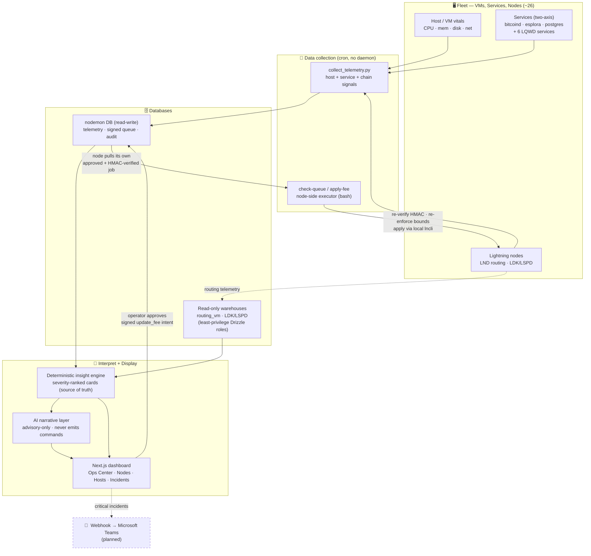

# NodeMonitor

A local-first **node-operator control tool** for the LQWD (~26-node) Lightning fleet — a mix of LND routing nodes and LDK/LSPD nodes.

NodeMonitor combines the *active controls* of Lightning Terminal / ThunderHub (fee & policy updates, channel closes, rebalances) with *curated, action-relevant analytics* drawn from the fleet's existing warehouses. It surfaces **which nodes, services, and channels need attention and why**, then lets the operator act safely. It is explicitly **not** a Grafana replacement: it carries just enough analytics to justify and target an action, and hides the firehose detail that doesn't drive a decision.

> **Core value — safe & accountable.** Every recommended action applies only via a **signed, operator-approved intent** executed with on-node credentials; higher-risk closures/rebalances are **exported as commands a human runs**. The dashboard holds **zero node credentials** and **never silently mutates** the fleet.

---

## Design at a glance

The system is a one-way telemetry pipeline with a single, tightly-gated write path back to the nodes:

```
VM / Services / Nodes  ──collect──▶  DB  ──▶  AI interpret + Dashboard display
                                             │
                                             ├──▶  alerts via webhook → Teams   (planned)
                                             │
                                             └──▶  operator approves in Dashboard
                                                         │
                                                         ▼
                                                   DB (signed queue)
                                                         │
                                                         ▼
                                              node reads + applies via lncli
```

Data flows **up** from the fleet into read-only warehouses; the dashboard only ever **reads** to display and interpret. The *only* way anything flows **back down** to a node is a command the operator explicitly approved, HMAC-signed in the queue DB, which the node itself pulls, re-verifies, and executes locally.

### Workflow diagram



---

## The five stages

### 1. VM / Services / Nodes → Data collection
Per-node scripts run on a cron **heartbeat** — no persistent daemon, agent, or AI on any node. They gather:
- **Host/VM vitals** — CPU, memory, disk, network, storage usage + growth (`scripts/fileserver/collect_telemetry.py`).
- **Two-axis service health** — for the infra trio (bitcoind / esplora / postgres) and the 6 custom LQWD services, each measured on **two independent axes**: `RUNNING` (process alive) and `FUNCTIONING NORMALLY` (heartbeat freshness, last-successful-run, error counts). A service is green **only when both are true** — the "up but dead" case is made unmistakable.
- **bitcoind / chain telemetry** — blocks-behind-tip, verification progress, peers, mempool.
- **Lightning routing data** — forwards, fees, channels, closes (landed in the existing warehouses).

Every signal carries a freshness/last-seen stamp; a stale or missing signal is represented **as stale — never silently rendered healthy**.

### 2. → Databases
Three connections, each on a least-privilege role, via Drizzle + postgres.js:
- **`routing_vm`** (read-only warehouse) — LND routing/forwarding history.
- **LDK / LSPD** (read-only warehouse) — the LSP node's channel state.
- **`nodemon`** (read-write) — the only DB NodeMonitor owns: telemetry tables, the signed command queue, and an append-only audit log.

Read-only is enforced **at the database** (SELECT-only grants), not just in code.

### 3. → AI interpret + Dashboard display
- A **deterministic insight engine** turns warehouse rows into severity-ranked recommendation cards (`{severity, node, target, signal, evidence, suggested_action, params}`). This is the **source of truth**.
- An optional **AI narrative layer** re-phrases what needs attention in plain operator language. It is **advisory-only, dismissible, and never produces or alters an executable parameter**.
- The **Next.js dashboard** renders it: the Ops Center overview (full-stack root-cause-grouped attention queue + fleet-vitals rollup), Nodes, Hosts, and Incident detail — all on the locked "Data-Forward" design system.

### 4. → Alerts via webhook to Teams *(planned)*
Critical incidents push to a **Microsoft Teams** channel via webhook so the operator is notified out-of-band. *(Design intent — not yet implemented.)*

### 5. Dashboard → DB → `lncli` actions
The single write path, tightly gated:
1. The operator reviews a recommendation and **approves** an `update_fee` intent in the dashboard.
2. It is written to the `nodemon` queue **HMAC-signed** (SHA-256, per-node secret) over a canonical payload, `pending_approval` → `approved`. Nothing runs until explicitly approved.
3. On its next tick the node's `check-queue` script reads **only its own pubkey's approved jobs**, **re-verifies the HMAC**, **re-enforces parameter bounds node-side**, and applies via local `lncli` (argv invocation, never shell-string interpolation).
4. Result + execution row + audit entry are written back, under a per-node write rate-limit.

Higher-risk closures/rebalances are **not** queued — they're **exported as ready-to-run commands** a human runs.

---

## Tech stack

| Layer | Choice |
|---|---|
| Web / API / RSC | Next.js 16 (App Router) + React 19 + TypeScript (strict) |
| Styling | Tailwind CSS v4 + shadcn/ui — locked "Data-Forward" tokens, IBM Plex Sans/Mono, brand navy `#1A3C79` |
| Charts | Recharts 3 |
| DB access | Drizzle ORM + postgres.js — read-only to warehouses, read-write to `nodemon` only |
| Signing | `node:crypto` HMAC-SHA256 (lowercase hex, key-sorted canonical JSON); verified node-side via `openssl dgst` |
| AI (optional) | Vercel AI SDK, default Claude via `@ai-sdk/anthropic` |
| Node scripts | bash (`check-queue`, `apply-fee`) + Python (`collect_telemetry.py`) |

## Repository layout

```
src/
  app/                     # Next.js App Router
    (overview)/            # Ops Center, /inbox, /queue, /pending, per-node console
    (design)/design-system # in-app primitive gallery
    actions/               # server actions (enqueue, approve, narrate)
  components/
    df/                    # Data-Forward design primitives (SeverityCard, TwoAxisPip, …)
    overview/              # overview-specific islands (QueueIsland, …)
  lib/
    db/                    # 3 Drizzle clients + boot health check + schema
    read/                  # curated warehouse read helpers (telemetry, service-health)
    insight/               # deterministic recommendation engine + detectors
    overview/              # root-cause grouping, vitals rollup, AI band, filters
    queue/                 # signed queue: enqueue / approve / claim / stub-executor
    export/                # client-side lncli/lncmd command builders (zero write path)
    scorecard/  format/  csv/  ai/  config/
scripts/
  fileserver/              # collectors + cron snippets + downloader (fleet rail)
  node/                    # node-side executor: check-queue, apply-fee
.planning/                 # GSD planning artifacts (roadmap, phases, state)
```

## Getting started

```bash
npm install

# configure DB URLs (local → VM is env-only, no code changes)
cp .env.example .env.local   # then set the warehouse + nodemon URLs

npm run dev          # http://localhost:3001
npm test             # vitest (pure units run without a DB; queue/* need a live nodemon DB)
npm run build        # production build
```

Boot reads DB URLs from env vars only and runs a health check that **fails loudly** if a warehouse is unreachable or not read-only. No `localhost` literals — the local→VM flip is configuration-only.

## Security posture

- Dashboard holds **zero** node credentials; credentials live only on the nodes.
- Every queued command is **HMAC-signed** with a per-node secret and **re-verified + bounds-re-enforced on the node**.
- **Atomic claim** (`SELECT … FOR UPDATE SKIP LOCKED`) prevents double-apply; TTL-expiry is fail-closed; a stale-claim reaper recovers stuck jobs.
- **Zero-write-path** on the read/display surfaces; the AI layer is proven to **never emit an executable command**.
- A **Grade-A security scan** (no CRITICAL/HIGH findings) is required before any production deploy.

## Project status

Built with the GSD phased workflow (`.planning/`). v1 (Phases 1–8) delivered the read layer, insight engine, command export, signed queue, and node heartbeat. **v2.0 "Operations Center"** is a full-stack redesign on the locked Data-Forward system:

| Phase | Status |
|---|---|
| 10. Design-System Foundation | ✅ Complete |
| 11. Full-Stack Telemetry Ingestion | ✅ Complete |
| 12. Ops Center Overview | ✅ Complete |
| 13. Nodes + Service Health | 🔵 In progress |
| 14. Hosts + Infra Monitoring | ⚪ Planned |
| 15. Incident Lifecycle + AI Explanation | ⚪ Planned |
| 16. Hardening + VM Deploy | ⚪ Planned |

See `.planning/ROADMAP.md` for the full phase breakdown.

---

*LQWD Technologies Corp. (TSX.V: LQWD) · brand navy `#1A3C79`.*
