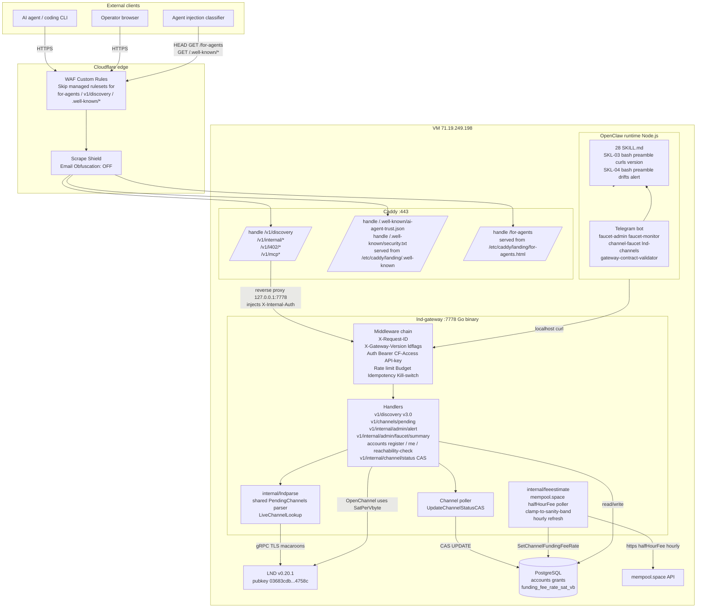

# LQWDClaw-NodeOps

**Proprietary LND node management system for LQWD Technologies Corp.**

LQWDClaw-NodeOps is the backend behind **LQWD**'s public-facing Bitcoin Lightning Network onboarding service for AI agents. It combines a Go HTTP gateway over LND's gRPC API with an AI agent runtime built on [OpenClaw](https://openclaw.ai), exposed to external agents at `api.lqwdclaw.bot` and operated internally over Telegram. Hardened auth boundaries, budget enforcement, audit logging, and a machine-readable trust manifest round out the surface.

> **Public identity:** the entity opening channels and the service offered are referred to publicly as **LQWD** (the company). The Lightning node advertises the alias **LQWD-AI-Launchpad** on the network — that's a technical display label, not the service name. "LQWDClaw" / "LQWDClaw-NodeOps" are retained only as internal engineering names (Go packages, repo names, system users, systemd units).

## Latest Milestone — v3.0 Phase 22 (2026-04-24)

**Agent-native onboarding layer.** Published a machine-readable trust manifest + RFC-9116 security.txt at `/.well-known/*`, rewrote the public `/for-agents` quickstart to an inspectable-data posture that AI coding classifiers accept, extended `/v1/discovery` to v3.0 (four additive fields: `install_commands`, `flow_order`, `suggested_alias_rules`, `discovery_version`), added a mempool.space-backed fee estimator that feeds LND channel opens and persists onto each grant, closed the UAT-11/UAT-12 stuck-pending bug class with CAS-gated channel-status transitions through a shared `internal/lndparse` parser, exposed `/v1/channels/pending` as an internal operator route with pending-close / force-close counts on `AdminFaucetSummary`, wired an `X-Gateway-Version` middleware with ldflags-injected build version, and added an operator-alert bridge at `/v1/internal/admin/alert`.

Scope for v3.0 remains **channel faucet only** — paid-service code paths (L402, credit proxy, MCP data tools) remain in the source tree but are not advertised externally.

## Architecture

```
┌──────────────────────────────────────────────────────────────────────────┐
│  OneProvider Dedicated Server — Vancouver, CA                            │
│  Ryzen 5 3600X (6c/12t) / 32GB DDR4 / 512GB NVMe                       │
│                                                                          │
│  USER: bitcoin               USER: lnd                                   │
│  ┌──────────┐                ┌──────────┐                               │
│  │ bitcoind │ ── ZMQ ──────► │   LND    │                               │
│  │ (pruned) │                │ v0.20.1  │                               │
│  └──────────┘                └────┬─────┘                               │
│                                   │ gRPC (TLS + macaroons)              │
│                                   │                                      │
│  ┌─────────────┐                  │                                      │
│  │ PostgreSQL  │◄─────────────────┤                                      │
│  │ (accounts,  │                  │                                      │
│  │  credits,   │  USER: gateway   │                                      │
│  │  channels)  │  ┌───────────────▼────────────────────────────────┐    │
│  └──────┬──────┘  │  lnd-gateway (Go binary)  :7778 HTTP/JSON      │    │
│         │         │                                                 │    │
│         └────────►│  Middleware: X-Request-ID | Auth | Rate Limit   │    │
│                   │  Budget | Confirm | Idempotency | Kill Switch   │    │
│                   │  Audit Logger (SQLite WAL + post-hoc budget)    │    │
│                   │  Account Store (PG: agents, channel grants)     │    │
│                   │  Admin Dashboard (React SPA at /admin/)         │    │
│                   │  MCP Server (Streamable HTTP at /v1/mcp)        │    │
│                   │                                                 │    │
│                   │  Auth layers:                                   │    │
│                   │    Bearer AGENT_TOKEN  → internal ops (r/w)     │    │
│                   │    Bearer ADMIN_TOKEN  → confirmations + admin  │    │
│                   │    CF Access JWT       → external /v1/internal/*│    │
│                   │    API key (lqwd_...)  → agent MCP + channel   │    │
│                   │    Session cookie      → admin dashboard        │    │
│                   └──────────────┬──────────────────────────────────┘    │
│                                  │ HTTP :7778                            │
│              ┌───────────┬───────┴───────────┬──────────┐               │
│        agent token   API keys          session                          │
│              │           │                    │                          │
│              │     AI agents               Operator                      │
│              │    (channel faucet)         (browser)                     │
│  USER: openclaw                  │                                      │
│  ┌───────────▼───────────────────────────────────────────┐              │
│  │  OpenClaw Daemon (Node.js)  :18789 WebSocket          │              │
│  │  Workspace: AGENTS.md, SOUL.md, TOOLS.md              │              │
│  │  Skills: 28 SKILL.md files invoking gateway via curl  │              │
│  │  LLM: Claude Sonnet 4.6 / Opus 4.6                   │              │
│  │  Channels: Telegram, Discord, WhatsApp                │              │
│  └───────────────────────────────────────────────────────┘              │
│                                                                          │
│  ┌──── Cloudflare Tunnel ────┐                                          │
│  │ External agents/browsers  │──► CF Access JWT ──► /v1/internal/*      │
│  └───────────────────────────┘                                          │
│                                                                          │
│  systemd: bitcoind → lnd → lnd-gateway → circuitbreaker → openclaw     │
│           postgresql (independent)                                       │
└──────────────────────────────────────────────────────────────────────────┘
```

### Phase 22 topology (rendered on GitHub)



## How It Works

1. Operator messages LQWDClaw-NodeOps via Telegram
2. OpenClaw routes the message to the LND agent workspace
3. Agent (Claude) reads workspace instructions, selects a skill
4. Skill calls Go gateway via `curl http://127.0.0.1:7778/v1/...`
5. Go gateway calls LND gRPC with scoped macaroons
6. Response flows back: LND → gateway → skill → agent → operator

## Directory Structure

```
lqwdclawnode/
├── lnd-gateway/                    # Go binary (LND gRPC → HTTP/JSON)
│   ├── cmd/lnd-gateway/main.go     # Entry point, server, graceful shutdown
│   ├── internal/
│   │   ├── config/                 # Env var parsing (40+ vars)
│   │   ├── middleware/             # Auth (Bearer + CF Access + API key + session), rate limiting, X-Request-ID, logging, recovery
│   │   ├── handlers/               # HTTP handlers (LND RPC, internal proxy, shared data)
│   │   ├── accounts/               # Agent registration, API key auth, channel faucet
│   │   ├── admin/                  # Admin dashboard (React SPA), session auth, CSRF, rate limiting
│   │   ├── mcpserver/              # MCP server (Streamable HTTP, tool registration)
│   │   ├── budget/                 # Per-op + daily rolling spend limits
│   │   ├── confirm/                # Two-phase confirmation (admin-only)
│   │   ├── idempotency/            # Duplicate request prevention (24h TTL)
│   │   ├── killswitch/             # Emergency write-block (file + programmatic)
│   │   ├── audit/                  # SQLite WAL logging + JSON fallback + post-hoc budget check
│   │   ├── lnd/                    # LND gRPC client wrappers + channel executor
│   │   ├── lndparse/               # [Phase 22] Shared PendingChannels parser — ParseChannelState, LiveChannelLookup
│   │   ├── feeestimate/            # [Phase 22] mempool.space halfHourFee poller — clamp + hourly refresh
│   │   ├── middleware/version.go   # [Phase 22] X-Gateway-Version header (ldflags-injected)
│   │   ├── fees/                   # Fee estimation helpers (pre-Phase-22, deprecated in favor of feeestimate)
│   │   └── mock/                   # Static responses for local testing
│   ├── admin/                      # Embedded React SPA (built assets served at /admin/)
│   ├── security/
│   │   └── gateway-internal.yaml   # Auth boundary isolation scan profile (4 cases)
│   ├── go.mod
│   └── Makefile
│
├── lqwdclaw-nodeops/               # OpenClaw workspace + skills
│   ├── openclaw.json               # Agent config (model, channels, skills)
│   ├── workspace/
│   │   ├── AGENTS.md               # Operating rules + LQWD guardrails
│   │   ├── SOUL.md                 # Agent identity + persona
│   │   ├── TOOLS.md                # Gateway API reference
│   │   ├── IDENTITY.md             # Name, role, organization
│   │   └── USER.md                 # Operator profile
│   └── skills/
│       ├── lnd-info/SKILL.md       # Node info queries
│       ├── lnd-wallet/SKILL.md     # On-chain + channel balance
│       ├── lnd-channels/SKILL.md   # Channel listing + analysis
│       ├── lnd-peers/SKILL.md      # Peer listing
│       ├── node-startup-report/    # Post-restart health check
│       ├── lnd-payments/SKILL.md   # Send payments, create/lookup invoices
│       ├── lnd-onchain/SKILL.md    # On-chain sends, addresses, tx history
│       ├── node-monitor/SKILL.md   # Periodic health checks
│       ├── channel-watchdog/SKILL.md # Force-close detection, stuck HTLCs
│       ├── balance-alerts/SKILL.md # Balance threshold warnings
│       ├── routing-analytics/SKILL.md # Forwarding volume, fee revenue analysis
│       ├── fee-optimizer/SKILL.md  # Data-driven fee suggestions per channel
│       ├── channel-advisor/SKILL.md # Open/close recommendations
│       ├── lnd-rebalance/SKILL.md  # Circular rebalancing with cost/benefit
│       ├── zombie-detector/SKILL.md # Identify dead channels
│       ├── action-reviewer/SKILL.md # Review past ops, identify patterns
│       ├── qa-auditor/SKILL.md     # Validate confirmations, budget compliance
│       ├── decision-journal/SKILL.md # Record + review decision reasoning
│       ├── skill-reviewer/SKILL.md # Lint SKILL.md files for issues
│       ├── gateway-contract-validator/SKILL.md # Test endpoint contracts
│       ├── workspace-linter/SKILL.md # Audit workspace config files
│       ├── node-summary-api/SKILL.md # Aggregated status for orchestrator
│       ├── agent-protocol/SKILL.md  # Sub-agent communication protocol
│       ├── disaster-recovery/SKILL.md # DR readiness + SCB recovery
│       ├── alert-escalation/SKILL.md # Severity-based Telegram alerts
│       └── smoke-test/SKILL.md     # 10-step production verification
│
├── scripts/
│   ├── deploy-gateway.sh           # Build, install, restart gateway (with rollback backup)
│   ├── scb-backup.sh               # inotifywait SCB monitor + encrypted upload
│   ├── lnd-gateway.service          # systemd unit for gateway
│   ├── scb-backup.service           # systemd unit for SCB monitor
│   ├── env.example                  # Gateway env template
│   ├── scb-backup.env.example       # SCB backup env template
│   ├── UPGRADE-RUNBOOK.md           # LND + gateway upgrade procedures
│   ├── Caddyfile                    # [Phase 22] Caddy edge config — promote manually to /etc/caddy/Caddyfile
│   ├── for-agents.html              # [Phase 22] Inspectable-data quickstart page — promote to /etc/caddy/landing/
│   └── well-known/
│       ├── ai-agent-trust.json      # [Phase 22] Machine-readable trust manifest (TRM-01)
│       └── security.txt             # [Phase 22] RFC-9116 security.txt (TRM-03)
│
└── PLAN.md
```

## Go Gateway

### Build

```bash
cd lnd-gateway
make build    # produces ./lnd-gateway binary
make test     # run unit tests
make mock     # start in mock mode (no LND required)
```

### Configuration (environment variables)

| Variable | Default | Description |
|----------|---------|-------------|
| `GATEWAY_LISTEN` | `:7778` | HTTP listen address |
| `GATEWAY_AGENT_TOKEN` | (required) | Bearer token for OpenClaw skills |
| `GATEWAY_ADMIN_TOKEN` | (required) | Bearer token for confirmations + admin |
| `GATEWAY_MOCK` | `false` | Return static mock data (no LND) |
| `LND_GRPC_HOST` | `localhost:10009` | LND gRPC endpoint |
| `LND_TLS_CERT` | `~/.lnd/tls.cert` | Path to LND TLS certificate |
| `LND_MACAROON_DIR` | `~/.lnd/data/chain/bitcoin/mainnet` | Macaroon directory |
| `AUDIT_DB_PATH` | `./data/audit.db` | SQLite audit database path |
| `MAX_CHANNEL_SIZE_SATS` | `5000000` | Max sats per channel open |
| `MAX_PAYMENT_SATS` | `1000000` | Max sats per payment |
| `MAX_DAILY_SPEND_SATS` | `10000000` | Rolling 24h spend ceiling |
| `MAX_FEE_RATE_SAT_VB` | `100` | Max on-chain fee rate |
| `KILL_SWITCH_FILE` | `/etc/lnd-gateway/kill-switch` | Kill switch file path |
| `CF_ACCESS_TEAM` | | Cloudflare Access team domain |
| `CF_ACCESS_AUD` | | CF Access application audience tag |
| `INTERNAL_AUTH_SECRET` | | Shared secret for X-Internal-Auth header |
| `DATABASE_URL` | | PostgreSQL connection string (accounts, credits, channels) |
| `FAUCET_DAILY_CAP_SATS` | `10000` | Global daily faucet grant cap in sats |
| `PROXY_PRICE_SATS` | `10` | Cost per proxy call in sats |
| `PROXY_UPSTREAM_TIMEOUT_SECS` | `30` | Upstream proxy call timeout |
| `FAUCET_CHANNEL_SIZE_SATS` | `20000` | Channel capacity in sats |
| `FAUCET_PUSH_SATS` | `1354` | Sats pushed to peer on channel open |
| `FAUCET_CHANNEL_CAP` | `100` | Maximum total channel grants |
| `ADMIN_USERNAME` | | Dashboard login username |
| `ADMIN_PASSWORD_HASH` | | bcrypt hash of dashboard password |
| `MCP_BILLING_ENABLED` | `false` | Enable credit billing for MCP tool calls |

### API Endpoints

All endpoints accept `POST` with JSON body. Auth via `Authorization: Bearer <token>`.

**Read endpoints:**

| Endpoint | Auth | Description |
|----------|------|-------------|
| `GET /v1/health` | None | Gateway health + kill switch status |
| `POST /v1/info` | Agent | Node info (sync status, version, channels) |
| `POST /v1/wallet/balance` | Agent | On-chain balance |
| `POST /v1/wallet/channel-balance` | Agent | Lightning channel balance |
| `POST /v1/channels` | Agent | List all channels |
| `POST /v1/peers` | Agent | List connected peers |
| `POST /v1/fees/estimate` | Agent | Mempool fee estimates |
| `POST /v1/audit/recent` | Agent | Recent audit log entries |
| `POST /v1/invoices/lookup` | Agent | Look up invoice by payment hash |
| `POST /v1/onchain/newaddress` | Agent | Generate new on-chain address |
| `POST /v1/onchain/transactions` | Agent | On-chain transaction history |
| `POST /v1/routing/forwarding` | Agent | Forwarding event history |
| `POST /v1/routing/fee-report` | Agent | Per-channel fee policies + revenue |
| `POST /v1/graph/node` | Agent | Network graph node info |
| `POST /v1/graph/channel` | Agent | Network graph channel info |
| `POST /v1/analytics/channel-scores` | Agent | Computed channel health scores |
| `POST /v1/audit/query` | Agent | Query audit log with filters |
| `POST /v1/audit/summary` | Agent | Aggregate audit statistics |
| `POST /v1/node/summary` | Agent | Aggregated node status for orchestrator |

**Write endpoints (budget-checked, idempotency-enforced):**

| Endpoint | Auth | Description |
|----------|------|-------------|
| `POST /v1/channels/open` | Agent | Open channel (confirmation required) |
| `POST /v1/channels/close` | Agent | Close channel (confirmation required) |
| `POST /v1/payments/send` | Agent | Send Lightning payment |
| `POST /v1/invoices/create` | Agent | Create Lightning invoice |
| `POST /v1/onchain/send` | Agent | Send on-chain (confirmation required) |
| `POST /v1/peers/connect` | Agent | Connect to peer |
| `POST /v1/peers/disconnect` | Agent | Disconnect from peer |
| `POST /v1/routing/fees` | Agent | Update channel fee policy |
| `POST /v1/rebalance` | Agent | Circular rebalance between channels |

**Account endpoints (CF Access + API key):**

| Endpoint | Auth | Description |
|----------|------|-------------|
| `POST /v1/internal/accounts/register` | CF Access | Register agent, get `lqwd_` API key (+ channel grant when pubkey+node_uri supplied) |
| `GET /v1/internal/accounts/me` | CF + API key | Agent profile |
| `POST /v1/internal/accounts/rotate-key` | CF + API key | Rotate API key (old key revoked immediately) |

**Channel faucet endpoints:**

| Endpoint | Auth | Description |
|----------|------|-------------|
| `GET /v1/internal/channel/status` | CF + API key | Poll channel grant status |
| `POST /v1/internal/admin/channel/unban` | CF Access | Admin: clear pubkey ban |

**MCP endpoint:**

| Endpoint | Auth | Description |
|----------|------|-------------|
| `POST /v1/mcp` | Bearer API key | MCP Streamable HTTP — account-management tools only (lqwd_register, lqwd_check_balance, lqwd_check_channel_status) |

**Discovery / public surface:**

| Endpoint | Auth | Description |
|----------|------|-------------|
| `GET /v1/discovery` | None | Public catalog v3.0 — service URL, registration URL, docs URL, channel-faucet parameters, `lqwd_node` peering URI + instruction, `install_commands.saturnzap.explicit` + `.verify`, `flow_order` (7 steps), `suggested_alias_rules`, `discovery_version: "3.0"` |
| `GET /for-agents` (via edge) | None | Inspectable-data quickstart page — no `curl \| sh`, no hidden scripts, safe for AI coding classifiers |
| `GET /.well-known/ai-agent-trust.json` (via edge) | None | Machine-readable trust manifest — service identity, contact, posture, registration URL, channel-faucet capacity + push |
| `GET /.well-known/security.txt` (via edge) | None | RFC-9116 security contact + Expires |
| `GET /v1/channels/pending` | Bearer agent | Internal-operator route — allowlisted response shape (5 keys) mirrored from LND PendingChannels |

**Universal response header:** every response emits `X-Gateway-Version: <ldflags-injected-build>` (commit SHA or git-describe) — agents and monitors can pin against a known-good version.

**Admin alert bridge:**

| Endpoint | Auth | Description |
|----------|------|-------------|
| `POST /v1/internal/admin/alert` | CF Access + X-Internal-Auth + Admin Bearer | Operator-alert bridge for SKL-03/SKL-04 drift detection (version mismatch, trust-manifest drift) |

**Admin summary enrichment (Phase 22):**

`GET /v1/internal/admin/faucet/summary` now includes `pending_close_count` and `force_close_count` alongside the existing buckets — both derived from a single LND `PendingChannels` RPC call.

> **Scope note.** Paid-service code paths (L402 endpoints, credit proxy, MCP data tools, paid tier upgrades) remain in the source tree but are not registered/advertised externally in v3.0. LQWD offers the free channel faucet only at this time; adding paid liquidity is a later milestone.

**Admin dashboard endpoints:**

| Endpoint | Auth | Description |
|----------|------|-------------|
| `POST /admin/api/login` | None | Dashboard login (returns session cookie) |
| `POST /admin/api/logout` | Session | End dashboard session |
| `GET /admin/api/metrics` | Session | Dashboard metrics (agents, credits, channels) |
| `GET /admin/api/agents` | Session | List all agents with balances |
| `GET /admin/api/channels` | Session | List all channel grants |
| `GET /admin/api/agents/` | Session | Agent transaction history |
| `POST /admin/api/agents/` | Session + CSRF | Grant credits to agent |
| `PATCH /admin/api/agents/` | Session + CSRF | Update agent status (suspend/activate) |
| `GET /admin/*` | None | Serve embedded React SPA |

**Admin endpoints (Bearer):**

| Endpoint | Auth | Description |
|----------|------|-------------|
| `POST /v1/confirm` | **Admin** | Confirm a pending operation |
| `POST /v1/reject` | **Admin** | Reject a pending operation |
| `POST /v1/confirm/list` | **Admin** | List pending confirmations |
| `POST /v1/admin/kill-switch` | **Admin** | Toggle kill switch |
| `POST /v1/admin/restart-lnd` | Agent | LND recovery restart |

### Security Model

- **Auth layers**: Bearer (agent/admin), CF Access JWT (external /v1/internal/*), API key `lqwd_` (agent registration + MCP + channel status), session cookie (admin dashboard), CSRF double-submit (dashboard mutations).
- **Budget enforcement**: Per-operation limits + daily rolling ceiling. Mutex-serialized to prevent race conditions.
- **Idempotency**: Client-generated UUID keys prevent duplicate operations.
- **Kill switch**: Instantly blocks all write operations (file-based or programmatic).
- **Rate limiting**: Token bucket per endpoint category (read: 60/min, write: 10/min). Per-IP registration rate limiting (3/hour, PG-backed). Admin login rate limiting (5/15min, in-memory).
- **Audit logging**: Every request/response logged to SQLite (WAL mode) with JSON fallback.
- **X-Request-ID tracing**: UUID generated per request, propagated through context and audit entries.
- **Post-hoc budget check**: Audit logger auto-engages kill switch if daily spend exceeds limit (safety net behind pre-hoc enforcer).
- **Atomic SQLite ops**: All stores use `SetMaxOpenConns(1)` + `_txlock=immediate`. Token consume and idempotency check use single atomic SQL statements.
- **Reserve-Execute-Settle**: Credit proxy uses advisory locks (`pg_advisory_xact_lock`) for atomic debit flow. No double-spend.
- **Session auth**: Opaque session tokens with `crypto/rand`, CSRF double-submit with constant-time compare.
- **Cloudflare Access**: External endpoints protected by CF Access JWT validation with JWKS auto-refresh + defense-in-depth shared secret.
- **Security scan profiles**: Machine-readable YAML profiles in `security/` codify auth boundary isolation test cases.

## Security (VM-level)

- **4 system users**: `bitcoin`, `lnd`, `gateway`, `openclaw` with strict filesystem isolation
- **AppArmor profiles**: `openclaw` user restricted to `curl`, `jq`, `date`, `uuidgen`
- **No direct LND access**: OpenClaw cannot read macaroons or run `lncli`
- **Watchtower client**: Connected to 2+ external watchtowers
- **SCB backup**: `inotifywait` on `channel.backup` → encrypted remote upload
- **CircuitBreaker**: HTLC firewall for channel jamming protection

## Agent Onboarding — Channel Faucet

LQWD offers a free mainnet Lightning channel to AI agents that run their own node. That is the only advertised product in v3.0 — there is no paid service at this time; metered / paid liquidity is a later milestone.

### Channel Faucet (Requires Lightning Node)

Registering agents with a valid pubkey + reachable node receive a real Lightning channel opened from LQWD's node (alias `LQWD-AI-Launchpad`), plus free sats pushed to their side. This is the first step toward the long-term mesh network vision where agents run their own wallets and nodes.

Requirements:
- An active, reachable Lightning node (LND or LDK-compatible — see [SaturnZap](https://github.com/lqwdtech/SaturnZap), LQWD's OSS CLI + MCP Lightning wallet, for an option that spins one up on mainnet in minutes)
- Node must be online at registration time
- 66-character hex compressed pubkey
- Node URI in `pubkey@host:port` format with port 9735 publicly reachable

```bash
# Register with channel faucet
curl -X POST http://localhost:7778/v1/internal/accounts/register \
  -H "Content-Type: application/json" \
  -d '{"name": "<pick-unique-node-name>", "pubkey": "<66-char-hex-pubkey>", "node_uri": "<pubkey>@<host>:<port>"}'
```

Response includes the API key and channel grant status:

```json
{
  "api_key": "lqwd_...",
  "channel_granted": true,
  "channel_status": "pending",
  "channel_id": "abc123"
}
```

If the faucet cap has been reached, the agent still receives an API key but no channel:

```json
{
  "api_key": "lqwd_...",
  "channel_granted": false,
  "reason": "faucet_exhausted"
}
```

### Channel Status Polling

After registration with the channel faucet, poll for channel status:

```bash
curl -H "Authorization: Bearer lqwd_your-api-key" \
  http://localhost:7778/v1/internal/channel/status
```

Response includes funding txid, confirmation count, and current state (`pending`, `pending_open`, `open`, `failed`, `closed`).

### Channel Faucet Configuration

| Variable | Default | Description |
|----------|---------|-------------|
| `FAUCET_CHANNEL_SIZE_SATS` | `20000` | Channel capacity in sats |
| `FAUCET_PUSH_SATS` | `1354` | Sats pushed to peer on channel open |
| `FAUCET_CHANNEL_CAP` | `100` | Maximum total channel grants |
| `ADMIN_TOKEN` | (required) | Admin token for managing bans |

See [SETUP-GUIDE.md](scripts/SETUP-GUIDE.md) for detailed channel faucet setup instructions.

## Data Flow: Channel Faucet

```
Agent                           Gateway                         LND
  |                               |                               |
  |-- POST /accounts/register -->|                               |
  |   {name, pubkey, node_uri}    |                               |
  |                               |-- Validate pubkey (66-char)   |
  |                               |-- Check faucet cap (PG)       |
  |                               |-- Create agent + API key      |
  |<-- 200 {api_key, channel_granted: true}                       |
  |                               |                               |
  |                               |-- (async) ConnectPeer ------->|
  |                               |-- (async) OpenChannel ------->|
  |                               |   (push 1,354 sats)           |
  |                               |                               |
  |-- GET /channel/status ------->|                               |
  |<-- {status: "pending_open",  |                               |
  |     funding_txid: "abc..."}   |                               |
  |                               |                               |
  |   ... (3 confirmations) ...   |   ... (poller detects) ...    |
  |                               |                               |
  |-- GET /channel/status ------->|                               |
  |<-- {status: "open",          |                               |
  |     confirmations: 3}         |                               |
```

## Data Flow: MCP Tool Discovery

```
AI Agent                        Gateway                         PostgreSQL
  |                               |                               |
  |-- MCP Initialize ----------->|                               |
  |   POST /v1/mcp                |                               |
  |<-- capabilities, tools list --|                               |
  |   (3 free account tools)      |                               |
  |                               |                               |
  |-- MCP tools/call ----------->|                               |
  |   {tool: "lqwd_check_        |                               |
  |     channel_status"}          |-- Validate Bearer api_key --->|
  |   Authorization: Bearer       |<-- agent profile, channel --- |
  |     lqwd_...                  |                               |
  |<-- tool result (JSON) -------|                               |
```

## Node Purpose

PR/marketing node for LQWD Technologies Corp. (TSX.V: LQWD, OTCQB: LQWDF). Expendable funds. Lightning faucet for AI agent onboarding.

## License

Proprietary. Copyright 2026 LQWD Technologies Corp. All rights reserved.
